# 8. Robotic Arm Depth Camera Application Course

## 8.1 Depth Map Pseudocolor Processing

### 8.1.1 Introduction

This section focuses on initializing the node and subscribing to the RGB image and depth image topics.

Next, image processing is performed to generate a pseudocolor image.

Finally, both the color image and pseudocolor image are streamed back and displayed on the screen.

### 8.1.2 Operating Steps

> [!NOTE]
>
> * **Command inputs are case-sensitive. Press the Tab key on the keyboard for keyword auto-completion.**
>
> * **Before powering on the robotic arm, make sure to secure the base to a desktop or stable platform using a G clamp. The robotic arm generates swinging motion and inertia during startup and operation. Failure to secure the base may cause the device to tip over, fall, or sustain damage, posing potential safety hazards.**

1) Start the robotic arm and connect to the remote control software **NoMachine**, with reference to [1. Tutorials / 1. NexArm User Manual / 1.5 Development Environment Setup and Configuration]().

2) Double-click the system desktop icon  to open the command line terminal. Enter the following command and press **Enter** to disable the auto-start service:

```bash
~/.stop_ros.sh
```

3) Enter the command to run the feature program and press **Enter**:

```bash
ros2 launch example get_depth_rgb_img.launch.py
```

4) To exit the feature, press **Ctrl+C**. If the shutdown fails, press it multiple times.

### 8.1.3 Program Outcome

After launching the feature, the robotic arm streams both the RGB color image and depth image onto the screen. Different color shades appear on the depth image depending on the distance of objects.

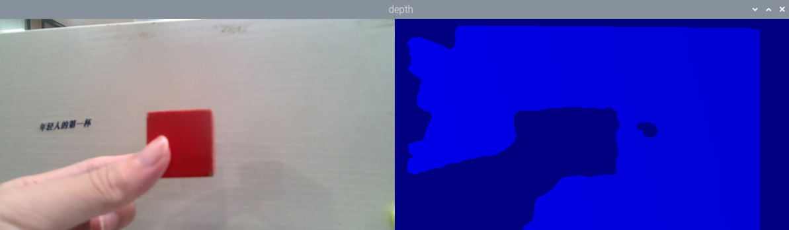

### 8.1.4 Program Analysis

* **Launch File Analysis**

The launch file is located at: **/home/ubuntu/ros2_ws/src/example/example/rgbd_function/get_depth_rgb_img.launch.py**

(1) `launch_setup` Function

```py
def launch_setup(context):
    compiled = os.environ.get('need_compile', 'False')

    if compiled == 'True':
        sdk_package_path = get_package_share_directory('sdk')
        peripherals_package_path = get_package_share_directory('peripherals')
    else:
        sdk_package_path = '/home/ubuntu/ros2_ws/src/driver/sdk'
        peripherals_package_path = '/home/ubuntu/ros2_ws/src/peripherals'

    sdk_launch = IncludeLaunchDescription(
        PythonLaunchDescriptionSource(
            os.path.join(sdk_package_path, 'launch/nexarm.launch.py')),
    )

    depth_camera_launch = IncludeLaunchDescription(
        PythonLaunchDescriptionSource(
            os.path.join(peripherals_package_path, 'launch/depth_camera.launch.py')),
    )

    get_depth_rgb_img_node = Node(
        package='example',
        executable='get_depth_rgb_img',
        output='screen',
    )

    return [depth_camera_launch,
            sdk_launch,
            get_depth_rgb_img_node,
            ]
```

This function loads **launch/nexarm.launch.py** from the **sdk** package to start the NexArm controller communication and servo control nodes, including servo driving and kinematics computation. It loads **launch/depth_camera.launch.py** from the **peripherals** package to start the depth camera node, providing RGB and depth image data. It defines the target node by declaring `get_depth_rgb_img_node` to execute the **get_depth_rgb_img** executable from the **example** package, which acquires and processes RGB and depth image data from the depth camera and outputs logs to the screen.

(2) `generate_launch_description` Function

```py
def generate_launch_description():
    return LaunchDescription([
        OpaqueFunction(function = launch_setup)
    ])
```

This function creates and returns a `LaunchDescription` object. It invokes the `launch_setup` function via `OpaqueFunction`, serving as the standard entry point for ROS 2 launch files.

(3) Main Function

```py
if __name__ == '__main__':
    # Create a launchDescription object
    ld = generate_launch_description()

    ls = LaunchService()
    ls.include_launch_description(ld)
    ls.run()
```

This function creates the `LaunchDescription` object and `LaunchService` service, adds the launch description to the launch service, and executes it to manually start the entire system.

* **Python File Analysis**

The Python file is located at: **/home/ubuntu/ros2_ws/src/example/example/rgbd_function/include/get_depth_rgb_img.py**

(1) Importing Packages

```py
import os
import cv2
import time
import rclpy
import queue
import threading
import numpy as np
import sdk.fps as fps
import mediapipe as mp
import message_filters
from rclpy.node import Node
from cv_bridge import CvBridge
from std_srvs.srv import SetBool
from std_srvs.srv import Trigger
from sensor_msgs.msg import Image, CameraInfo
from rclpy.executors import MultiThreadedExecutor
from servo_controller_msgs.msg import ServosPosition
from rclpy.callback_groups import ReentrantCallbackGroup
from servo_controller.bus_servo_control import set_servo_position
```

1. **import sdk.fps as fps**: Import the custom `fps` module for frame rate computation.

2. **import mediapipe as mp**: Import the MediaPipe library for image processing and human pose recognition.

3. **import message_filters**: Import the `message_filters` module to handle message subscription synchronization.

4. **from servo_controller_msgs.msg import ServosPosition**: Import the `ServosPosition` message type from `servo_controller_msgs.msg` for servo position control.

5. **from rclpy.callback_groups import ReentrantCallbackGroup**: Import `ReentrantCallbackGroup` from `rclpy.callback_groups` to handle callbacks that can be reentered in multi-threaded execution.

6. **from servo_controller.bus_servo_control import set_servo_position**: Import the `set_servo_position` function from `servo_controller.bus_servo_control` to set servo positions.

(2) `GetRgbAndDepthNode` Initialization Function

```py
    def __init__(self, name):
        rclpy.init()
        super().__init__(name)
        self.running = True
        self.fps = fps.FPS()

        self.image_queue = queue.Queue(maxsize=2)
        self.joints_pub = self.create_publisher(ServosPosition, '/servo_controller', 1) 
        self.client = self.create_client(Trigger, '/controller_manager/init_finish')
        self.client.wait_for_service()
        # self.client = self.create_client(SetBool, '/depth_cam/set_ldp_enable')
        # self.client.wait_for_service()

        rgb_sub = message_filters.Subscriber(self, Image, '/depth_cam/rgb/image_raw')
        depth_sub = message_filters.Subscriber(self, Image, '/depth_cam/depth/image_raw')
        self.get_logger().info(f"1")
        info_sub = message_filters.Subscriber(self, CameraInfo, '/depth_cam/depth/camera_info')
        self.get_logger().info(f"2")
        # Synchronize timestamps, allowing up to 0.02 s error
        sync = message_filters.ApproximateTimeSynchronizer([rgb_sub, depth_sub, info_sub], 3, 2)
        sync.registerCallback(self.multi_callback) # Register callback function
        
        timer_cb_group = ReentrantCallbackGroup()
        self.timer = self.create_timer(0.0, self.init_process, callback_group=timer_cb_group)
```

This function initializes the ROS node, sets the running status flag `running`, and configures the frame rate counter `fps`. It creates a thread-safe image queue `image_queue` to buffer synchronized image data, creates the servo control publisher `joints_pub`, and waits for the robotic arm controller service to start. It subscribes to the RGB image, depth image, and camera intrinsics through `message_filters`, synchronizes their timestamps using `ApproximateTimeSynchronizer` allowing an error of 0.02 s, and registers the callback function `multi_callback` to process synchronized data. It also starts the initialization timer `timer` for subsequent initialization operations.

(3) `init_process` Method

```py
    def init_process(self):
        self.timer.cancel()

        msg = SetBool.Request()
        msg.data = False
        # self.send_request(self.client, msg)

        set_servo_position(self.joints_pub, 1.5, ((1, 500), (2, 500), (3, 330), (4, 900), (5, 700), (6, 500)))
        time.sleep(1.5)
        
        threading.Thread(target=self.main, daemon=True).start()
        self.create_service(Trigger, '~/init_finish', self.get_node_state)
        self.get_logger().info('\033[1;32m%s\033[0m' % 'start')
```

This method cancels the initialization timer and controls the servos of the robotic arm to reset to the initial position within 1.5 s. It starts the main logic thread via the `main` method, creates the `~/init_finish` service to report node readiness, and outputs a startup log.

(4) `get_node_state` Function

```py
    def get_node_state(self, request, response):
        response.success = True
        return response
```

This function acts as the service callback function to return the successful initialization state of the node by setting `response.success = True`.

(5) `multi_callback` Function

```py
    def multi_callback(self, ros_rgb_image, ros_depth_image, depth_camera_info):
        if self.image_queue.full():

            # If the queue is full, discard the oldest image
            self.image_queue.get()
        # Put the image into the queue
        self.image_queue.put((ros_rgb_image, ros_depth_image, depth_camera_info))
```

This callback function processes synchronized data by storing the synchronized RGB image, depth image, and camera intrinsics into the image queue. When the queue is full, the oldest data is dropped to ensure that the main logic thread always retrieves time-aligned multi-source data.

(6) `main` Method

```py
    def main(self):
        while self.running:
            try:
                ros_rgb_image, ros_depth_image, depth_camera_info = self.image_queue.get(block=True, timeout=1)
            except queue.Empty:
                if not self.running:
                    break
                else:
                    continue
            try:
                rgb_image = np.ndarray(shape=(ros_rgb_image.height, ros_rgb_image.width, 3), dtype=np.uint8, buffer=ros_rgb_image.data)
                #self.get_logger().info(f"rgb_image shape before crop: {rgb_image.shape}") 
                #rgb_image = rgb_image[0:440,]
                #self.get_logger().info(f"rgb_image shape after crop: {rgb_image.shape}")  

                depth_image = np.ndarray(shape=(ros_depth_image.height, ros_depth_image.width), dtype=np.uint16, buffer=ros_depth_image.data)
                #self.get_logger().info(f"depth_image shape: {depth_image.shape}")        
                h, w = depth_image.shape[:2]

                depth = np.copy(depth_image).reshape((-1, ))
                depth[depth<=0] = 0
                sim_depth_image = np.clip(depth_image, 0, 4000).astype(np.float64)
                sim_depth_image = sim_depth_image / 2000.0 * 255.0
                #bgr_image = cv2.cvtColor(rgb_image, cv2.COLOR_RGB2BGR)  # Remove this line
                depth_color_map = cv2.applyColorMap(sim_depth_image.astype(np.uint8), cv2.COLORMAP_JET)

                if len(depth_color_map.shape) == 2:
                    depth_color_map = cv2.cvtColor(depth_color_map, cv2.COLOR_GRAY2BGR)
                
                result_image = np.concatenate([rgb_image, depth_color_map], axis=1) 
                cv2.imshow("depth", result_image)
                key = cv2.waitKey(1)
                if key != -1:
                    self.running = False


            except Exception as e:
                self.get_logger().info('error: ' + str(e))
```

This method executes the main logic loop to process data from the image queue. It retrieves the synchronized RGB and depth images and converts them into NumPy arrays. It processes the depth image by clipping invalid values less than or equal to 0, mapping the depth range 0 to 4000 to 0 to 255, and applying the JET pseudocolor colormap to generate a colored depth map. It concatenates the RGB image with the colored depth map horizontally and displays them in an OpenCV window named `depth`. It listens for keyboard input and terminates the program when any key is pressed.

---

## 8.2 Distance Measurement

### 8.2.1 Introduction

This section focuses on initializing the node and retrieving the topic information for both RGB and depth images.

Next, image processing is carried out to calculate pixel distances.

Finally, the processed color image and pseudocolor image are streamed back, enabling distance measurement and reset at clicked points via mouse clicks.

### 8.2.2 Operating Steps

> [!NOTE]
>
> * **Command inputs are case-sensitive. Press the Tab key on the keyboard for keyword auto-completion.**
>
> * **Before powering on the robotic arm, make sure to secure the base to a desktop or stable platform using a G clamp. The robotic arm generates swinging motion and inertia during startup and operation. Failure to secure the base may cause the device to tip over, fall, or sustain damage, posing potential safety hazards.**

1) Start the robotic arm and connect to the remote control software **NoMachine**, with reference to [1. Tutorials / 1. NexArm User Manual / 1.5 Development Environment Setup and Configuration]().

2) Double-click the system desktop icon  to open the command line terminal. Enter the following command and press **Enter** to disable the auto-start service:

```bash
~/.stop_ros.sh
```

3) Enter the command to run the feature program and press **Enter**:

```bash
ros2 launch example distance_measure.launch.py
```

4) To exit the feature, press **Ctrl+C**. If the shutdown fails, press it multiple times.

### 8.2.3 Program Outcome

After launching the feature, the robotic arm streams the RGB color image and depth image onto the screen. The closest point and its measured distance are marked on the depth image. Clicking the left mouse button marks a specific point and displays its distance. Double-clicking the left mouse button or clicking the scroll wheel clears the marked point and restores minimum distance measurement.

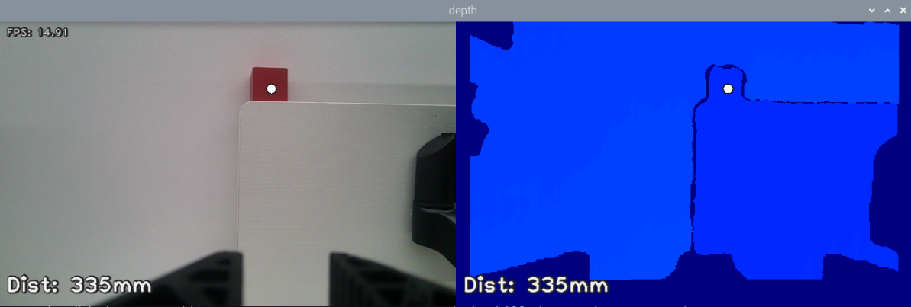

### 8.2.4 Program Analysis

* **Launch File Analysis**

The launch file is located at: **/home/ubuntu/ros2_ws/src/example/example/rgbd_function/distance_measure.launch.py**

(1) `launch_setup` Function

```py
def launch_setup(context):
    compiled = os.environ.get('need_compile', 'False')

    if compiled == 'True':
        sdk_package_path = get_package_share_directory('sdk')
        peripherals_package_path = get_package_share_directory('peripherals')
    else:
        sdk_package_path = '/home/ubuntu/ros2_ws/src/driver/sdk'
        peripherals_package_path = '/home/ubuntu/ros2_ws/src/peripherals'

    sdk_launch = IncludeLaunchDescription(
        PythonLaunchDescriptionSource(
            os.path.join(sdk_package_path, 'launch/nexarm.launch.py')),
    )

    depth_camera_launch = IncludeLaunchDescription(
        PythonLaunchDescriptionSource(
            os.path.join(peripherals_package_path, 'launch/depth_camera.launch.py')),
    )

    distance_measure_node = Node(
        package='example',
        executable='distance_measure',
        output='screen',
    )

    return [depth_camera_launch,
            sdk_launch,
            distance_measure_node,
            ]
```

This function includes external launch files: It loads **launch/nexarm.launch.py** from the **sdk** package to start the NexArm controller communication and servo control nodes, such as servo driving and kinematics computation. It loads **launch/depth_camera.launch.py** from the **peripherals** package to start the depth camera node, providing RGB images and depth data. It defines the target node: It declares `distance_measure_node` to execute the **distance_measure** executable from the **example** package, which measures distances between targets and the camera and outputs logs to the screen.

(2) `generate_launch_description` Function

```py
def generate_launch_description():
    return LaunchDescription([
        OpaqueFunction(function = launch_setup)
    ])
```

This function creates and returns a `LaunchDescription` object. It invokes the `launch_setup` function via `OpaqueFunction`, serving as the standard entry point for ROS 2 launch files.

(3) Main Function

```py
if __name__ == '__main__':
    # Create a launchDescription object
    ld = generate_launch_description()

    ls = LaunchService()
    ls.include_launch_description(ld)
    ls.run()
```

This function creates the `LaunchDescription` object and `LaunchService` service, adds the launch description to the launch service, and executes it to manually start the entire system.

* **Python File Analysis**

The Python file is located at: **/home/ubuntu/ros2_ws/src/example/example/rgbd_function/include/distance_measure.py**

(1) Importing Packages

```py
import os
import cv2
import time
import rclpy
import queue
import threading
import numpy as np
import sdk.fps as fps
import mediapipe as mp
import message_filters
from rclpy.node import Node
from cv_bridge import CvBridge
from std_srvs.srv import SetBool
from std_srvs.srv import Trigger
from sensor_msgs.msg import Image, CameraInfo
from rclpy.executors import MultiThreadedExecutor
from servo_controller_msgs.msg import ServosPosition
from rclpy.callback_groups import ReentrantCallbackGroup
from servo_controller.bus_servo_control import set_servo_position
```

1. **import sdk.fps as fps**: Import the custom `fps` module to compute and track frame rates.

2. **import mediapipe as mp**: Import the MediaPipe library to handle computer vision tasks such as pose estimation.

3. **import message_filters**: Import `message_filters` to synchronize multiple sensor messages, such as depth images and RGB images.

4. **from servo_controller_msgs.msg import ServosPosition**: Import the `ServosPosition` message type from `servo_controller_msgs.msg` for servo position control.

5. **from rclpy.callback_groups import ReentrantCallbackGroup**: Import `ReentrantCallbackGroup` from `rclpy.callback_groups` to implement reentrant callback groups for multi-threaded callbacks.

6. **from servo_controller.bus_servo_control import set_servo_position**: Import the `set_servo_position` function from `servo_controller.bus_servo_control` to set target positions of servos.

(2) `DistanceMeasureNode` Initialization Function

```py
class DistanceMeasureNode(Node):

    def __init__(self, name):
        rclpy.init()
        super().__init__(name)
        self.running = True
        self.fps = fps.FPS()

        self.image_queue = queue.Queue(maxsize=2)
        self.joints_pub = self.create_publisher(ServosPosition, '/servo_controller', 1) # Servo control
        
        self.client = self.create_client(Trigger, '/controller_manager/init_finish')
        self.client.wait_for_service()
        # self.client = self.create_client(SetBool, '/depth_cam/set_ldp_enable')
        # self.client.wait_for_service()

        rgb_sub = message_filters.Subscriber(self, Image, '/depth_cam/rgb/image_raw')
        depth_sub = message_filters.Subscriber(self, Image, '/depth_cam/depth/image_raw')

        # Synchronize timestamps, allowing up to 0.02 s error
        sync = message_filters.ApproximateTimeSynchronizer([rgb_sub, depth_sub], 4, 0.5)
        sync.registerCallback(self.multi_callback) # Register callback function
        
        timer_cb_group = ReentrantCallbackGroup()
        self.timer = self.create_timer(0.0, self.init_process, callback_group=timer_cb_group)
        self.target_point = None
        self.last_event = 0
        cv2.namedWindow("depth")
        cv2.setMouseCallback('depth', self.click_callback)
        threading.Thread(target=self.main, daemon=True).start()
```

This function initializes the ROS node, sets the running status flag `running`, and configures the frame rate counter `fps`. It creates a thread-safe image queue `image_queue` and the servo control publisher `joints_pub`, waiting for the robotic arm controller service to start. It subscribes to RGB and depth images through `message_filters`, synchronizes them with `ApproximateTimeSynchronizer` allowing an error of 0.5 s, and registers the callback function `multi_callback` to handle synchronized data. It starts the initialization timer `timer`, sets the mouse callback function for interactive selection of measurement points, and starts the main logic thread via the `main` method.

(3) `init_process` Function

```py
    def init_process(self):
        self.timer.cancel()

        msg = SetBool.Request()
        msg.data = False
        #self.send_request(self.client, msg)

        #set_servo_position(self.joints_pub, 1.5, ((1, 500), (2, 500), (3, 330), (4, 900), (5, 700), (6, 500)))
        set_servo_position(self.joints_pub, 1.5, ((6, 500), (5, 600), (4, 785), (3, 110), (2, 500), (1, 210)))
        time.sleep(1)

        # threading.Thread(target=self.main, daemon=True).start()
        self.get_logger().info('\033[1;32m%s\033[0m' % 'start')
```

This function cancels the initialization timer, controls the servos to reset the robotic arm to the initial position within 1.5 s, and outputs a startup log.

(4) `multi_callback` Function

```py
    def multi_callback(self, ros_rgb_image, ros_depth_image):
        if self.image_queue.full():

            # If the queue is full, discard the oldest image
            self.image_queue.get()
        # Put the image into the queue
        self.image_queue.put((ros_rgb_image, ros_depth_image))
```

This callback function stores synchronized RGB and depth images into the image queue. When the queue is full, the oldest data is dropped to ensure that the main logic thread receives time-aligned image pairs.

(5) `click_callback` Function

```py
    def click_callback(self, event, x, y, flags, params):
        if event == cv2.EVENT_RBUTTONDOWN or event == cv2.EVENT_MBUTTONDOWN or event == cv2.EVENT_LBUTTONDBLCLK:
            self.target_point = None
        if event == cv2.EVENT_LBUTTONDOWN and self.last_event != cv2.EVENT_LBUTTONDBLCLK:
            if x >= 640:
                self.target_point = (x - 640, y)
            else:
                self.target_point = (x, y)
        self.last_event = event
```

This function handles mouse interaction callbacks. A left-click sets the measurement target point, whether clicking in the RGB image or depth map area, with coordinates automatically mapped. A right-click, middle-click, or left double-click clears the target point and restores automatic measurement of the closest point.

(6) `send_request` Function

```py
     def send_request(self, client, msg):
         future = client.call_async(msg)
         while rclpy.ok():
             if future.done() and future.result():
                 return future.result()
```

This function calls the asynchronous service client method `call_async` to send requests and return a future object representing the result.

(7) `main` Method

```py
    def main(self):
        while self.running:
            try:
                ros_rgb_image, ros_depth_image = self.image_queue.get(block=True, timeout=1)
            except queue.Empty:
                if not self.running:
                    break
                else:
                    self.get_logger().info('\033[1;31m%s\033[0m' % 'sdsdfsd')
                    continue
            try:
                rgb_image = np.ndarray(shape=(ros_rgb_image.height, ros_rgb_image.width, 3), dtype=np.uint8, buffer=ros_rgb_image.data)
                depth_image = np.ndarray(shape=(ros_depth_image.height, ros_depth_image.width), dtype=np.uint16, buffer=ros_depth_image.data)

                h, w = depth_image.shape[:2]

                depth = np.copy(depth_image).reshape((-1, ))
                depth[depth<=0] = 55555
                min_index = np.argmin(depth)
                min_y = min_index // w
                min_x = min_index - min_y * w
                if self.target_point is not None:
                    min_x, min_y = self.target_point

                sim_depth_image = np.clip(depth_image, 0, 2000).astype(np.float64) / 2000 * 255
                depth_color_map = cv2.applyColorMap(sim_depth_image.astype(np.uint8), cv2.COLORMAP_JET)

                txt = 'Dist: {}mm'.format(depth_image[min_y, min_x])
                cv2.circle(depth_color_map, (int(min_x), int(min_y)), 8, (32, 32, 32), -1)
                cv2.circle(depth_color_map, (int(min_x), int(min_y)), 6, (255, 255, 255), -1)
                cv2.putText(depth_color_map, txt, (11, 380), cv2.FONT_HERSHEY_PLAIN, 2.0, (32, 32, 32), 6, cv2.LINE_AA)
                cv2.putText(depth_color_map, txt, (10, 380), cv2.FONT_HERSHEY_PLAIN, 2.0, (240, 240, 240), 2, cv2.LINE_AA)
                
                # Color space conversion
                bgr_image = rgb_image  # Further conversion if needed
                # bgr_image = cv2.cvtColor(rgb_image, cv2.COLOR_RGB2BGR)  

                # Ensure sizes match
                depth_color_map = cv2.resize(depth_color_map, (rgb_image.shape[1], rgb_image.shape[0]))

                # Ensure depth_color_map is in BGR format
                if len(depth_color_map.shape) == 2:
                    depth_color_map = cv2.cvtColor(depth_color_map, cv2.COLOR_GRAY2BGR)

                cv2.circle(bgr_image, (int(min_x), int(min_y)), 8, (32, 32, 32), -1)
                cv2.circle(bgr_image, (int(min_x), int(min_y)), 6, (255, 255, 255), -1)
                cv2.putText(bgr_image, txt, (11, h - 20), cv2.FONT_HERSHEY_PLAIN, 2.0, (32, 32, 32), 6, cv2.LINE_AA)
                cv2.putText(bgr_image, txt, (10, h - 20), cv2.FONT_HERSHEY_PLAIN, 2.0, (240, 240, 240), 2, cv2.LINE_AA)

                self.fps.update()
                # bgr_image = self.fps.show_fps(bgr_image)
                result_image = np.concatenate([bgr_image, depth_color_map], axis=1)
                result_image = self.fps.show_fps(result_image)
                cv2.imshow("depth", result_image)
                key = cv2.waitKey(1)

            except Exception as e:
                self.get_logger().info('error: ' + str(e))
        rclpy.shutdown()
```

This method executes the main logic loop to process data from the image queue. It reads synchronized RGB and depth images and converts them into NumPy arrays. Measurement logic: If no target point is manually selected, it automatically detects the closest point with the minimum depth value in the depth image. If a target point is selected, it uses the depth value of that specified point. Depth map visualization: It maps the depth range 0 to 2000 mm into pseudocolor using the JET colormap, draws markers at the measurement point, and displays the distance text in millimeters. Image concatenation: It concatenates the RGB image and colored depth map horizontally, displays the frame rate, and presents real-time interaction through an OpenCV window named `depth`.

---

## 8.3 Depth Map Conversion

### 8.3.1 Introduction

This section focuses on initializing the node and retrieving topic information for RGB and depth images.

Next, image processing is performed to combine RGB and depth images into an RGBD image, which is then converted into point cloud data.

Finally, the point cloud data is cropped and streamed for visualization.

### 8.3.2 Operating Steps

> [!NOTE]
>
> * **Command inputs are case-sensitive. Press the Tab key on the keyboard for keyword auto-completion.**
>
> * **Before powering on the robotic arm, make sure to secure the base to a desktop or stable platform using a G clamp. The robotic arm generates swinging motion and inertia during startup and operation. Failure to secure the base may cause the device to tip over, fall, or sustain damage, posing potential safety hazards.**

1) Start the robotic arm and connect to the remote control software **NoMachine**, with reference to [1. Tutorials / 1. NexArm User Manual / 1.5 Development Environment Setup and Configuration]().

2) Double-click the system desktop icon  to open the command line terminal. Enter the following command and press **Enter** to disable the auto-start service:

```bash
~/.stop_ros.sh
```

3) Enter the command to run the feature program and press **Enter**:

```bash
ros2 launch example rgb_depth_to_pointcloud.launch.py
```

4) To exit the feature, press **Ctrl+C**. If the shutdown fails, press it multiple times.

### 8.3.3 Program Outcome

After launching the feature, the cropped point cloud data is converted and displayed in a visualization window. Point clouds can be inspected from different viewing angles by holding and dragging the left mouse button or the scroll wheel. Scrolling the mouse wheel zooms in or out on the point cloud for detailed inspection.

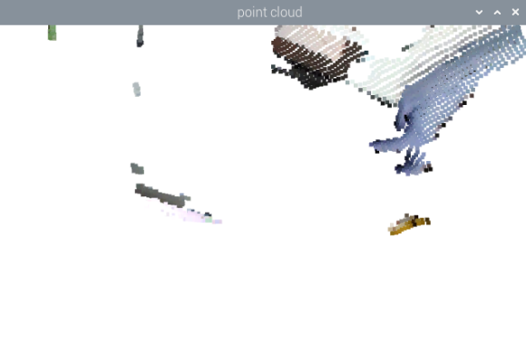

### 8.3.4 Program Analysis

* **Launch File Analysis**

The launch file is located at: **/home/ubuntu/ros2_ws/src/example/example/rgbd_function/rgb_depth_to_pointcloud.launch.py**

(1) `launch_setup` Function

```py
def launch_setup(context):
    compiled = os.environ.get('need_compile', 'False')

    if compiled == 'True':
        sdk_package_path = get_package_share_directory('sdk')
        peripherals_package_path = get_package_share_directory('peripherals')
    else:
        sdk_package_path = '/home/ubuntu/ros2_ws/src/driver/sdk'
        peripherals_package_path = '/home/ubuntu/ros2_ws/src/peripherals'

    sdk_launch = IncludeLaunchDescription(
        PythonLaunchDescriptionSource(
            os.path.join(sdk_package_path, 'launch/nexarm.launch.py')),
    )

    depth_camera_launch = IncludeLaunchDescription(
        PythonLaunchDescriptionSource(
            os.path.join(peripherals_package_path, 'launch/depth_camera.launch.py')),
    )

    rgb_depth_to_pointcloud_node = Node(
        package='example',
        executable='rgb_depth_to_pointcloud',
        output='screen',
    )

    return [depth_camera_launch,
            sdk_launch,
            rgb_depth_to_pointcloud_node,
            ]
```

This function includes external launch files: It loads **launch/nexarm.launch.py** from the **sdk** package to start the NexArm controller communication and servo control nodes, such as servo driving and kinematics computation, providing hardware support for arm movements. It loads **launch/depth_camera.launch.py** from the **peripherals** package to start the depth camera node, providing RGB images and depth data as raw input for point cloud generation. It defines the target node: It declares `rgb_depth_to_pointcloud_node` to execute the **rgb_depth_to_pointcloud** executable from the **example** package, converting synchronized RGB images and depth data into 3D point clouds and outputting logs to the screen.

(2) `generate_launch_description` Function

```py
def generate_launch_description():
    return LaunchDescription([
        OpaqueFunction(function = launch_setup)
    ])
```

This function creates and returns a `LaunchDescription` object. It invokes the `launch_setup` function via `OpaqueFunction`, serving as the standard entry point for ROS 2 launch files.

(3) Main Function

```py
if __name__ == '__main__':
    # Create a launchDescription object
    ld = generate_launch_description()

    ls = LaunchService()
    ls.include_launch_description(ld)
    ls.run()
```

This function creates the `LaunchDescription` object and `LaunchService` service, adds the launch description to the launch service, and executes it to manually start the entire system.

* **Python File Analysis**

The Python file is located at: **/home/ubuntu/ros2_ws/src/example/example/rgbd_function/include/rgb_depth_to_pointcloud.py**

(1) Importing Packages

```py
import os
import cv2
import time
import rclpy
import queue
import signal
import threading
import numpy as np
from sdk import pid
import open3d as o3d
import message_filters
from rclpy.node import Node
from std_srvs.srv import Trigger
from std_srvs.srv import SetBool
from geometry_msgs.msg import Twist
from sensor_msgs.msg import Image, CameraInfo
from rclpy.executors import MultiThreadedExecutor
from servo_controller_msgs.msg import ServosPosition
from rclpy.callback_groups import ReentrantCallbackGroup
from servo_controller.bus_servo_control import set_servo_position
```

1. **from sdk import pid**: Import `pid` from the `sdk` module for proportional, integral, and derivative control algorithms.

2. **from rclpy.executors import MultiThreadedExecutor**: Import `MultiThreadedExecutor` from `rclpy.executors` to run ROS 2 nodes and callback functions across multiple threads.

3. **from servo_controller_msgs.msg import ServosPosition**: Import the `ServosPosition` message type from `servo_controller_msgs.msg` to control servo positions.

4. **from servo_controller.bus_servo_control import set_servo_position**: Import the `set_servo_position` function from `servo_controller.bus_servo_control` to set servo positions.

(2) `TrackObjectNode` Initialization Function

```py
class TrackObjectNode(Node):
    def __init__(self, name):
        rclpy.init()
        super().__init__(name, allow_undeclared_parameters=True, automatically_declare_parameters_from_overrides=True)
        signal.signal(signal.SIGINT, self.shutdown)
        self.scale = 4
        self.proc_size = [int(640/self.scale), int(480/self.scale)]
        self.haved_add = False
        self.get_point = False
        self.display = True
        self.running = True
        self.pc_queue = queue.Queue(maxsize=1)
        self.target_cloud = o3d.geometry.PointCloud() # Point cloud to display

        self.t0 = time.time()
        self.joints_pub = self.create_publisher(ServosPosition, '/servo_controller', 0) # Servo control

        timer_cb_group = ReentrantCallbackGroup()

        self.client = self.create_client(Trigger, '/controller_manager/init_finish')
        self.client.wait_for_service()

        # self.client = self.create_client(SetBool, '/depth_cam/set_ldp_enable')
        # self.client.wait_for_service()

        camera_name = 'depth_cam'
        rgb_sub = message_filters.Subscriber(self, Image, '/%s/rgb/image_raw' % camera_name)
        depth_sub = message_filters.Subscriber(self, Image, '/%s/depth/image_raw' % camera_name)
        info_sub = message_filters.Subscriber(self, CameraInfo, '/%s/depth/camera_info' % camera_name)

        # Synchronize timestamps with allowed 0.02 s error
        sync = message_filters.ApproximateTimeSynchronizer([rgb_sub, depth_sub, info_sub], 3, 2)
        sync.registerCallback(self.multi_callback)  # Register callback function

        self.timer = self.create_timer(0.0, self.init_process, callback_group=timer_cb_group)
```

This function initializes the ROS node and configures core parameters and components. It sets the scaling factor `scale=4` and processing resolution `proc_size` to reduce computational overhead. It defines the point cloud queue `pc_queue` and target point cloud object `target_cloud`. It creates the servo control publisher `joints_pub` and waits for the robotic arm controller service to start. It subscribes to RGB images, depth images, and camera intrinsics via `message_filters`, synchronizes them with `ApproximateTimeSynchronizer` allowing an error of 2 s, and registers the callback function `multi_callback` to process synchronized data. It starts the initialization timer `timer` for setup tasks and registers interrupt signal handling via the `shutdown` method to ensure a clean exit.

(3) `init_process` Method

```py
    def init_process(self):
        self.timer.cancel()

        set_servo_position(self.joints_pub, 1, ((6, 500), (5, 765), (4, 915), (3, 150), (2, 500), (1, 200)))

        msg = SetBool.Request()
        msg.data = False
        #self.send_request(self.client, msg)

        threading.Thread(target=self.main, daemon=True).start()
        self.create_service(Trigger, '~/init_finish', self.get_node_state)
        self.get_logger().info('\033[1;32m%s\033[0m' % 'start')
```

This method cancels the initialization timer and controls the servos to reset the robotic arm to the specified position within 1 s. It starts the main logic thread via the `main` method, creates the `~/init_finish` service to report node readiness, and outputs a startup log.

(4) `get_node_state` Function

```py
    def get_node_state(self, request, response):
        response.success = True
        return response
```

This function serves as the service callback function to return the node initialization status with `response.success = True`, notifying other nodes that the current node is ready.

(5) `multi_callback` Function

```py
    def multi_callback(self, ros_rgb_image, ros_depth_image, depth_camera_info):
        print("multi_callback called")   # Confirm callback function is called
        try:
            # Convert ROS Image to numpy array
            rgb_image = np.ndarray(shape=(ros_rgb_image.height, ros_rgb_image.width, 3), dtype=np.uint8, buffer=ros_rgb_image.data)
            depth_image = np.ndarray(shape=(ros_depth_image.height, ros_depth_image.width), dtype=np.uint16, buffer=ros_depth_image.data)

            print(f"RGB Image Shape: {rgb_image.shape}, Depth Image Shape: {depth_image.shape}") # Print image shapes
            print(f"RGB Image dtype: {rgb_image.dtype}, Depth Image dtype: {depth_image.dtype}") # Print data types

            rgb_image = cv2.resize(rgb_image, tuple(self.proc_size), interpolation=cv2.INTER_NEAREST)
            depth_image = cv2.resize(depth_image, tuple(self.proc_size), interpolation=cv2.INTER_NEAREST)
            intrinsic = o3d.camera.PinholeCameraIntrinsic(int(depth_camera_info.width / self.scale),
                                                               int(depth_camera_info.height / self.scale),
                                                               float(depth_camera_info.k[0] / self.scale), float(depth_camera_info.k[4] / self.scale),
                                                               float(depth_camera_info.k[2] / self.scale), float(depth_camera_info.k[5] / self.scale))

            print(f"Intrinsic Matrix: {intrinsic.intrinsic_matrix}")   # Print intrinsic matrix

            o3d_image_rgb = o3d.geometry.Image(rgb_image)
            o3d_image_depth = o3d.geometry.Image(np.ascontiguousarray(depth_image))

            # rgbd_function --> point_cloud
            rgbd_image = o3d.geometry.RGBDImage.create_from_color_and_depth(o3d_image_rgb, o3d_image_depth, convert_rgb_to_intensity=False)
            # High CPU usage
            pc = o3d.geometry.PointCloud.create_from_rgbd_image(rgbd_image, intrinsic)#, extrinsic=extrinsic)ic)

            print(f"Point Cloud Size: {len(pc.points)}") # Add print statements

            # Remove the largest plane, such as the ground, distance threshold 4 mm, number of neighboring points, number of iterations
            plane_model, inliers = pc.segment_plane(distance_threshold=0.05,
                     ransac_n=10,
                     num_iterations=50)

            # Retain inliers
            inlier_cloud = pc.select_by_index(inliers, invert=True)
            self.target_cloud.points = inlier_cloud.points
            self.target_cloud.colors = inlier_cloud.colors

            # Rotate 180 degrees for better viewing
            self.target_cloud.transform(np.asarray([[1, 0, 0, 0], [0, -1, 0, 0], [0, 0, -1, 0], [0, 0, 0, 1]]))
            try:
                self.pc_queue.put_nowait(self.target_cloud)
                print("Point cloud enqueued")  # Confirm point cloud has been enqueued
            except queue.Full:
                pass

        except BaseException as e:
            print('callback error:', e)
        self.t0 = time.time()
```

This function implements core logic for synchronized data processing to convert image data into point clouds. It receives synchronized RGB images, depth images, and camera intrinsics, converts them into NumPy arrays, and scales them down to reduce computational load. It creates an Open3D `PinholeCameraIntrinsic` object based on camera parameters, then constructs an Open3D `RGBDImage` from RGB and depth images. It generates a point cloud using `create_from_rgbd_image`, segments planes using the RANSAC algorithm primarily to eliminate the ground plane, and retains non-planar points as the target point cloud `target_cloud`. It transforms point cloud coordinates by rotating 180° around the X-axis for better visualization, and pushes the processed point cloud into `pc_queue` for the main thread to render.

(6) `main` Method

```py
    def main(self):
        if self.display:
            # Create a visualization window
            vis = o3d.visualization.Visualizer()
            vis.create_window(window_name='point cloud', width=640, height=400, visible=1)
        while self.running:
            if not self.haved_add:
                if self.display:
                    try:
                        point_cloud = self.pc_queue.get(block=True, timeout=2)
                        print("Point cloud dequeued") # Confirm point cloud has been dequeued
                    except queue.Empty:
                        continue
                    vis.add_geometry(point_cloud)
                self.haved_add = True
            if self.haved_add:
                try:
                    point_cloud = self.pc_queue.get(block=True, timeout=2)
                    print("Point cloud dequeued") # Confirm point cloud has been dequeued
                except queue.Empty:
                    continue
                # Refresh
                points = np.asarray(point_cloud.points)
                print(f"Points array shape: {points.shape}")  # Confirm the shape of the points array

                if len(points) > 0:
                    twist = Twist()
                    min_index = np.argmax(points[:, 2])
                    min_point = points[min_index]
                    if len(point_cloud.colors) < min_index:
                        continue
                    point_cloud.colors[min_index] = [255, 255, 0]

                    if self.display:
                        vis.update_geometry(point_cloud)
                        #o3d.io.write_point_cloud("output.ply", point_cloud)

                        vis.poll_events()
                        vis.update_renderer()

            else:
                time.sleep(0.01)
        # Destroy all displayed geometries
        vis.destroy_window()
        self.get_logger().info('\033[1;32m%s\033[0m' % 'shutdown')
        rclpy.shutdown()
```

This method handles point cloud visualization and target tracking in the main logic thread. When `display=True` enables visualization, it creates the Open3D visualization window `vis`. It continuously retrieves data from the point cloud queue. On initial reception, it adds the point cloud to the visualizer. In subsequent updates, it locates the point with the maximum Z-coordinate, which typically represents the closest point, and highlights it with the yellow RGB value `[255, 255, 0]`. It refreshes the visualization window in real time until `running` becomes `False`, then destroys the window and shuts down ROS.

---

## 8.4 Height Detection and Gripping

### 8.4.1 Introduction

This section focuses on initializing the node and subscribing to the RGB and depth image topic information.

Next, image processing is conducted to obtain the pixel coordinates of the tallest object within the field of view.

Coordinate transformation is then performed to convert the pixel coordinates into robotic arm world coordinates.

Finally, trajectory planning is executed to control the robotic arm to pick up and place the larger wooden block.

### 8.4.2 Operating Steps

> [!NOTE]
>
> * **Command inputs are case-sensitive. Press the Tab key on the keyboard for keyword auto-completion.**
>
> * **Before powering on the robotic arm, make sure to secure the base to a desktop or stable platform using a G clamp. The robotic arm generates swinging motion and inertia during startup and operation. Failure to secure the base may cause the device to tip over, fall, or sustain damage, posing potential safety hazards.**
>
> * **Refer to [1. Tutorials / 1. NexArm User Manual / 1.9 Object Grasping Adjustment]() to calibrate the robotic arm position beforehand. Failure to calibrate may affect block gripping accuracy.**

1) Start the robotic arm and connect to the remote control software **NoMachine**, with reference to [1. Tutorials / 1. NexArm User Manual / 1.5 Development Environment Setup and Configuration]().

2) Double-click the system desktop icon  to open the command line terminal. Enter the following command and press **Enter** to disable the auto-start service:

```bash
~/.stop_ros.sh
```

3) Enter the command to run the feature program and press **Enter**:

```bash
ros2 launch example remove_too_high.launch.py
```

4) Once the feature starts, the robotic arm streams both RGB color and depth images onto the screen. Press **S** in the image display window to start gripping. Press **A** to stop gripping.

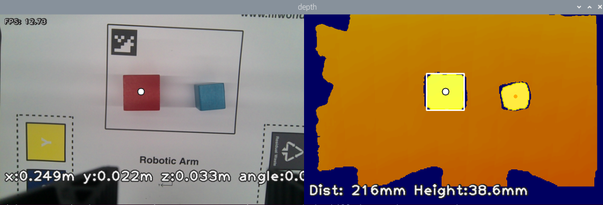

5) To exit the feature, press **Ctrl+C**. If the shutdown fails, press it multiple times.

### 8.4.3 Program Outcome

After launching the feature, place 30 × 30 mm and 40 × 40 mm wooden blocks into the recognition area. The robotic arm determines the block type based on height and picks up the larger block.

### 8.4.4 Program Analysis

* **Launch File Analysis**

The launch file is located at: **/home/ubuntu/ros2_ws/src/example/example/rgbd_function/remove_too_high.launch.py**

(1) `launch_setup` Function

```py
def launch_setup(context):
    compiled = os.environ.get('need_compile', 'False')

    if compiled == 'True':
        sdk_package_path = get_package_share_directory('sdk')
        peripherals_package_path = get_package_share_directory('peripherals')
    else:
        sdk_package_path = '/home/ubuntu/ros2_ws/src/driver/sdk'
        peripherals_package_path = '/home/ubuntu/ros2_ws/src/peripherals'

    sdk_launch = IncludeLaunchDescription(
        PythonLaunchDescriptionSource(
            os.path.join(sdk_package_path, 'launch/nexarm.launch.py')),
    )

    depth_camera_launch = IncludeLaunchDescription(
        PythonLaunchDescriptionSource(
            os.path.join(peripherals_package_path, 'launch/depth_camera.launch.py')),
    )

    remove_too_high_node = Node(
        package='example',
        executable='remove_too_high',
        output='screen',
    )

    return [depth_camera_launch,
            sdk_launch,
            remove_too_high_node,
            ]
```

This function loads **launch/nexarm.launch.py** from the **sdk** package to start the NexArm controller communication and servo control nodes, such as servo driving and kinematics computation. It loads **launch/depth_camera.launch.py** from the **peripherals** package to start the depth camera node, providing RGB images and depth data. It declares `remove_too_high_node` to execute the **remove_too_high** executable from the **example** package to filter out excessively high points and retain effective regions, outputting logs to the screen.

(2) `generate_launch_description` Function

```py
def generate_launch_description():
    return LaunchDescription([
        OpaqueFunction(function = launch_setup)
    ])
```

This function creates and returns a `LaunchDescription` object. It invokes the `launch_setup` function via `OpaqueFunction`, serving as the standard entry point for ROS 2 launch files.

(3) Main Function

```py
if __name__ == '__main__':
    # Create a launchDescription object
    ld = generate_launch_description()

    ls = LaunchService()
    ls.include_launch_description(ld)
    ls.run()
```

This function creates the `LaunchDescription` object and `LaunchService` service, adds the launch description to the launch service, and executes it to manually start the entire system.

* **Python File Analysis**

The Python file is located at: **/home/ubuntu/ros2_ws/src/example/example/rgbd_function/include/remove_too_high.py**

(1) Importing Packages

```py
import cv2
import math
import time
import rclpy
import queue
import threading
import numpy as np
import message_filters
from rclpy.node import Node
from sdk import common, fps
from std_srvs.srv import Trigger
from sensor_msgs.msg import Image, CameraInfo
from rclpy.executors import MultiThreadedExecutor
from servo_controller_msgs.msg import ServosPosition
from ros_robot_controller_msgs.msg import BuzzerState
from rclpy.callback_groups import ReentrantCallbackGroup
from kinematics.kinematics_control import set_pose_target
from kinematics_msgs.srv import GetRobotPose, SetRobotPose
from servo_controller.bus_servo_control import set_servo_position
```

1. **from sdk import common, fps**: Import `common` and `fps` modules from the `sdk` package, providing utility functions and frame rate monitoring tools.

2. **from sensor_msgs.msg import Image, CameraInfo**: Import `Image` and `CameraInfo` message types from the ROS 2 `sensor_msgs` package to process image data and camera metadata.

3. **from servo_controller_msgs.msg import ServosPosition**: Import the `ServosPosition` message type from the `servo_controller_msgs` package for servo control commands.

4. **from ros_robot_controller_msgs.msg import BuzzerState**: Import the `BuzzerState` message type from the `ros_robot_controller_msgs` package to control buzzer states.

5. **from kinematics.kinematics_control import set_pose_target**: Import the `set_pose_target` function from `kinematics.kinematics_control` to configure target robot poses.

6. **from kinematics_msgs.srv import GetRobotPose, SetRobotPose**: Import `GetRobotPose` and `SetRobotPose` service types from the `kinematics_msgs` package to query and set robot poses.

7. **from servo_controller.bus_servo_control import set_servo_position**: Import the `set_servo_position` function from `servo_controller.bus_servo_control` to set servo positions.

(2) `depth_pixel_to_camera` Function

```py
def depth_pixel_to_camera(pixel_coords, depth, intrinsics):
    """
    Convert depth pixel coordinates to XYZ in camera coordinate system (unit: meters)
    intrinsics: (fx, fy, cx, cy)
    """
    fx, fy, cx, cy = intrinsics
    px, py = pixel_coords
    x = (px - cx) * depth / fx
    y = (py - cy) * depth / fy
    z = depth
    return np.array([x, y, z])
```

This function calculates the 3D coordinates x, y, and z in the camera coordinate frame using camera intrinsic parameters, including fx, fy, cx, and cy, alongside the pixel depth value through perspective projection formulas.

(3) `RemoveTooHighObjectNode` Initialization Function

```py
    def __init__(self, name='remove_too_high'):
        # Initialize ROS
        rclpy.init()
        super().__init__(name, allow_undeclared_parameters=True, automatically_declare_parameters_from_overrides=True)

        # State variables
        self.endpoint = None
        self.fps = fps.FPS()
        self.last_shape = "none"
        self.moving = False
        self.running = True
        self.stamp = time.time()
        self.count = 0
        self.last_position = (0, 0, 0)
        self.start_process = False   # Key-controlled start flag
        self.last_pitch_yaw = (0, 0)

        # Message queues and publishers
        self.image_queue = queue.Queue(maxsize=2)
        self.joints_pub = self.create_publisher(ServosPosition, '/servo_controller', 1)
        self.buzzer_pub = self.create_publisher(BuzzerState, '/ros_robot_controller/set_buzzer', 1)

        # Clients for kinematics
        self.get_current_pose_client = self.create_client(GetRobotPose, '/kinematics/get_current_pose')
        self.get_current_pose_client.wait_for_service()
        self.set_pose_target_client = self.create_client(SetRobotPose, '/kinematics/set_pose_target')
        self.set_pose_target_client.wait_for_service()

        # Services: keep but synchronize keyboard control
        timer_cb_group = ReentrantCallbackGroup()
        self.create_service(Trigger, '~/start', self.start_srv_callback)
        self.create_service(Trigger, '~/stop', self.stop_srv_callback, callback_group=timer_cb_group)
        self.create_service(Trigger, '~/init_finish', self.get_node_state)

        # Subscribe RGB, Depth, CameraInfo synchronously
        rgb_sub = message_filters.Subscriber(self, Image, '/depth_cam/rgb/image_raw')
        depth_sub = message_filters.Subscriber(self, Image, '/depth_cam/depth/image_raw')
        info_sub = message_filters.Subscriber(self, CameraInfo, '/depth_cam/depth/camera_info')
        sync = message_filters.ApproximateTimeSynchronizer([rgb_sub, depth_sub, info_sub], 3, 0.08)
        sync.registerCallback(self.multi_callback)

        # Start initialization timer
        timer_cb_group2 = ReentrantCallbackGroup()
        self.timer = self.create_timer(0.0, self.init_process, callback_group=timer_cb_group2)

        self.get_logger().info("Node initialized, awaiting input: press s to start, a to stop, ESC to exit")
```

This method configures operating parameters, initializes publishers for servos and the buzzer, starts service servers for starting and stopping, and creates clients for kinematics pose services. It subscribes to RGB images, depth images, and camera intrinsics synchronously via `message_filters`, and starts the initialization timer.

(4) `init_process` Function

```py
    def init_process(self):
        # Execute only once
        try:
            self.timer.cancel()
        except Exception:
            pass

        # Move initial servos to safe position
        try:
            set_servo_position(self.joints_pub, 1, ((6, 500), (5, 600), (4, 825), (3, 110), (2, 500), (1, 210)))
            time.sleep(2)
        except Exception as e:
            self.get_logger().info("Error setting initial servo positions: " + str(e))

        # Start main thread
        threading.Thread(target=self.main, daemon=True).start()
        self.get_logger().info("Main thread started")
```

This function cancels the initialization timer, controls the robotic arm to reset to its initial position, starts the main loop thread, and outputs readiness logs along with instructions to press **S** to start or stop processing.

(5) `start_srv_callback` and `stop_srv_callback` Functions

```py
    def start_srv_callback(self, request, response):
        # Service start also synchronizes feature
        self.start_process = True
        response.success = True
        response.message = "start"
        self.get_logger().info("Start feature via ROS Service equivalent to pressing s")
        return response

    def stop_srv_callback(self, request, response):
        # Service stop also synchronizes stop feature
        self.start_process = False
        self.moving = False
        self.count = 0
        self.last_position = (0, 0, 0)
        # Move robot to safe pose
        try:
            set_servo_position(self.joints_pub, 1, ((6, 500), (5, 600), (4, 785), (3, 110), (2, 500), (1, 210)))
        except Exception as e:
            self.get_logger().info("Error setting servo positions on stop: " + str(e))
        response.success = True
        response.message = "stop"
        self.get_logger().info("Stop feature via ROS Service equivalent to pressing a")
        return response
```

`RemoveTooHighObjectNode.init_process(self)` cancels the initialization timer, controls the robotic arm to reset to its initial position, starts the main loop thread, and outputs the node-ready log along with operation prompts, such as pressing `s` to start or stop processing. `RemoveTooHighObjectNode.start_srv_callback(self, request, response)` sets `start_process=True`, starts the object detection and robotic arm grasping logic, and returns a success response.

(6) `send_request` Function

```py
    def send_request(self, client, msg):
        """
        Send asynchronous request and wait for response
        """
        future = client.call_async(msg)
        while rclpy.ok():
            if future.done():
                try:
                    result = future.result()
                    return result
```

It calls services asynchronously, such as the robotic arm pose service, and waits for the result via `rclpy.spin_until_future_complete` to ensure reliable service communication.

(7) `multi_callback` Function

```py
    def multi_callback(self, ros_rgb_image, ros_depth_image, depth_camera_info):
        # Put synchronized images into queue and pop oldest if full
        if self.image_queue.full():
            try:
                self.image_queue.get_nowait()
            except Exception:
                pass
        self.image_queue.put((ros_rgb_image, ros_depth_image, depth_camera_info))
```

This function stores synchronized RGB images, depth images, and camera intrinsics into the thread-safe queue `image_queue` for main loop processing.

(8) `get_endpoint` Function

```py
    def get_endpoint(self):
        """
        Get current robot end-effector pose and cache matrix
        """
        res = self.send_request(self.get_current_pose_client, GetRobotPose.Request())
        if res is None:
            return None
        endpoint = res.pose
        self.endpoint = common.xyz_quat_to_mat(
            [endpoint.position.x, endpoint.position.y, endpoint.position.z],
            [endpoint.orientation.w, endpoint.orientation.x, endpoint.orientation.y, endpoint.orientation.z]
        )
        return self.endpoint
```

This function calls the `get_current_pose` service to obtain the current end-effector position and orientation, converting them into a 4 × 4 transformation matrix `endpoint` for subsequent coordinate transformations from camera coordinates to robotic arm coordinates.

(9) `get_plane_values` Function

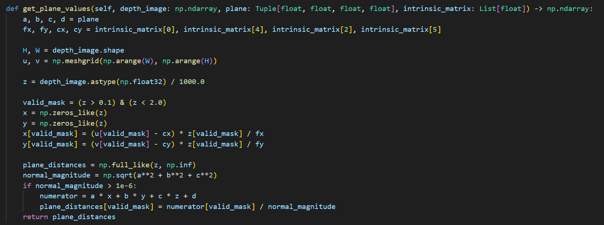

This function calculates the vertical distance from each valid pixel in the depth image to the reference plane based on the plane equation `plane` and camera intrinsic matrix `intrinsic_matrix`, generating a height map where positive values indicate points above the plane and negative values indicate points below.

(10) `robust_plane_values` Function

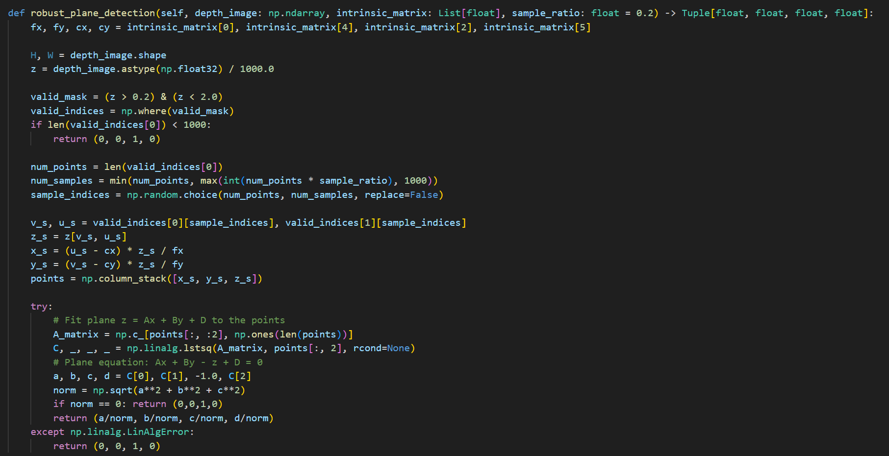

This function samples valid pixels from the depth image while filtering out invalid depth values, fits the plane equation Ax + By + Cz + D = 0 using least squares fitting, and returns normalized plane coefficients.

(11) `pick` Function

```py
    def pick(self, position, angle):
        """
        Pick process: check for possible stop requests during picking
        position: world coordinates (x,y,z)
        angle: minimum bounding rectangle angle of object
        """
        # Normalize angle
        angle = angle % 90
        angle = angle - 90 if angle > 40 else (angle + 90 if angle < -45 else angle)
        yaw = 80

        # Buzzer alert
        try:
            msg = BuzzerState()
            msg.freq = 1900
            msg.on_time = 0.2
            msg.off_time = 0.01
            msg.repeat = 1
            # self.buzzer_pub.publish(msg)
        except Exception:
            pass

        # Apply pick_offset based on coordinates
        if position[0] > 0.21:
            offset_x = self.pick_offset[0]
        else:
            offset_x = self.pick_offset[1]
        if position[1] > 0:
            offset_y = self.pick_offset[2]
        else:
            offset_y = self.pick_offset[3]
        offset_z = self.pick_offset[-1]

        position = list(position)  # Ensure mutable
        position[0] += offset_x
        position[1] += offset_y
        position[2] += offset_z

        # Check for stop request at each step
        def abort_if_stopped():
            if not self.start_process:
                self.get_logger().info("Stop command detected, aborting pick and returning to safe position")
                self.moving = False
                try:
                    # Return to safe position
                    set_servo_position(self.joints_pub, 1, ((6, 500), (5, 600), (4, 815), (3, 110), (2, 500), (1, 210)))
                except Exception:
                    pass
                return True
            return False

        # Start a series of movements, checking after each step
        try:
            # First pose planning and movement
            if abort_if_stopped():
                return
            msg = set_pose_target(position, yaw, [-180.0, 180.0], 1.0)
            res = self.send_request(self.set_pose_target_client, msg)
            if res and res.pulse:
                servo_data = res.pulse
                set_servo_position(self.joints_pub, 1.5, ((6, servo_data[0]), (5, servo_data[1]), (4, servo_data[2]), (3, servo_data[3])))
                time.sleep(1.5)
            if abort_if_stopped():
                return

            # Control gripper angle
            angle_val = 500 + int(1000 * (angle + (res.rpy[-1] if res and hasattr(res, 'rpy') else 0)) / 240)
            set_servo_position(self.joints_pub, 0.5, ((2, angle_val),))
            time.sleep(0.5)
            if abort_if_stopped():
                return

            # Refine pose again
            msg = set_pose_target(position, yaw, [-180.0, 180.0], 1.0)
            res = self.send_request(self.set_pose_target_client, msg)
            if res and res.pulse:
                servo_data = res.pulse
                set_servo_position(self.joints_pub, 1.5, ((6, servo_data[0]), (5, servo_data[1]), (4, servo_data[2]), (3, servo_data[3])))
                time.sleep(1.5)
            if abort_if_stopped():
                return

            # Close gripper
            set_servo_position(self.joints_pub, 1.0, ((1, 600),))
            time.sleep(1)
            if abort_if_stopped():
                return

            # Reset and lift again to simulate placing action
            msg = set_pose_target(position, yaw, [-180.0, 180.0], 1.0)
            res = self.send_request(self.set_pose_target_client, msg)
            if res and res.pulse:
                servo_data = res.pulse
                set_servo_position(self.joints_pub, 1.5, ((6, servo_data[0]), (5, servo_data[1]), (4, servo_data[2]), (3, servo_data[3])))
                time.sleep(1.5)
            if abort_if_stopped():
                return

            # A series of pulses to move the robotic arm back to a safe position
            set_servo_position(self.joints_pub, 1.0, ((6, 500), (5, 740), (4, 900), (3, 260), (2, 500)))
            time.sleep(1)
            if abort_if_stopped():
                return
            set_servo_position(self.joints_pub, 1.0, ((6, 150), (5, 635), (4, 900), (3, 260), (2, 500)))
            time.sleep(1)
            if abort_if_stopped():
                return
            set_servo_position(self.joints_pub, 1.0, ((6, 150), (5, 600), (4, 875), (3, 175), (2, 500)))
            time.sleep(1)
            if abort_if_stopped():
                return
            set_servo_position(self.joints_pub, 1.0, ((6, 150), (5, 600), (4, 875), (3, 175), (2, 500), (1, 200)))
            time.sleep(1)
            set_servo_position(self.joints_pub, 1, ((6, 500), (5, 600), (4, 815), (3, 110), (2, 500), (1, 210)))
            time.sleep(1)
```

This method controls the robotic arm to complete the sequence of opening the gripper, moving above the target, adjusting the angle, descending to grasp, lifting, moving to the placement point, releasing, and resetting, ensuring that excessively tall objects are removed.

(12) `main_loop` Function

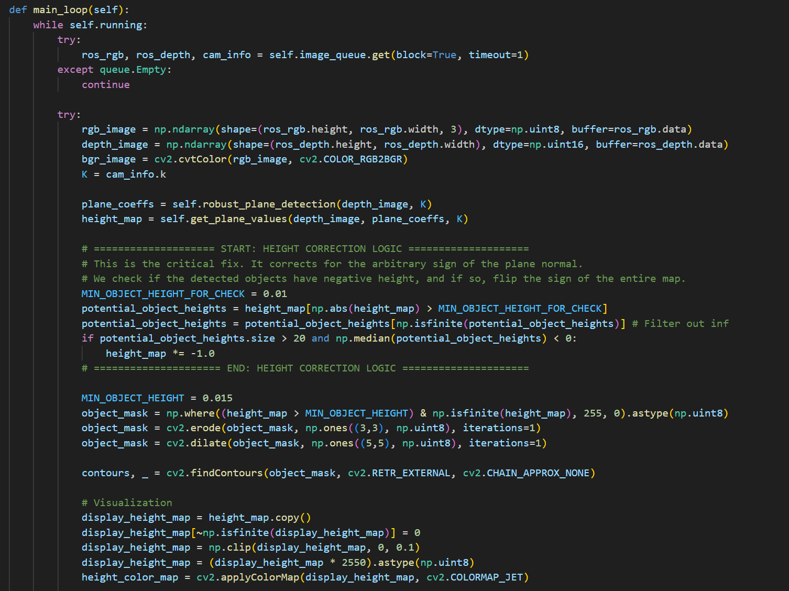

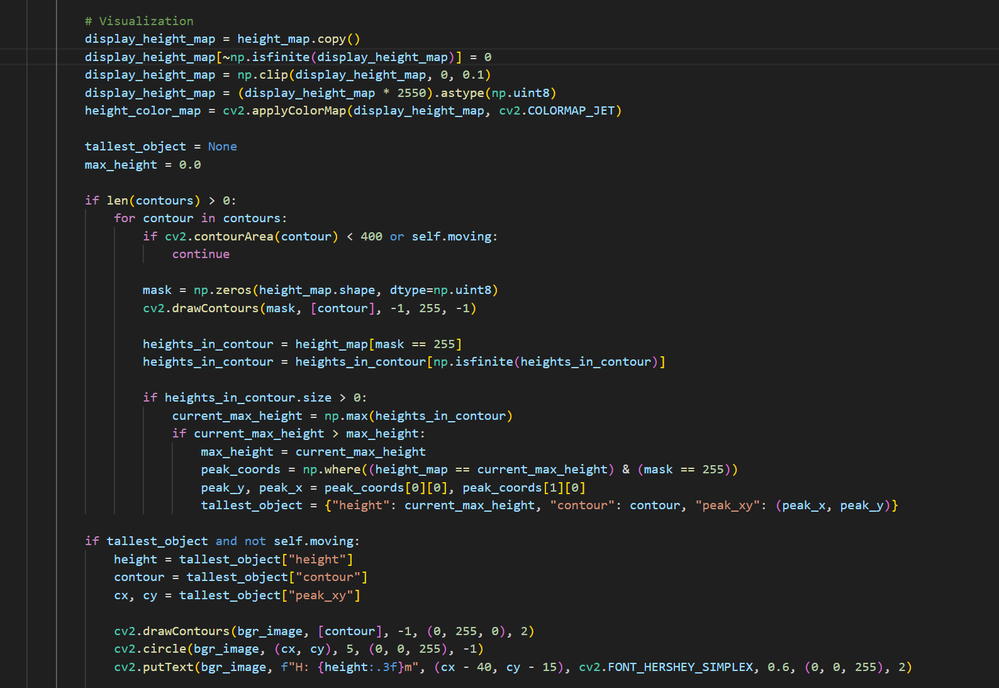

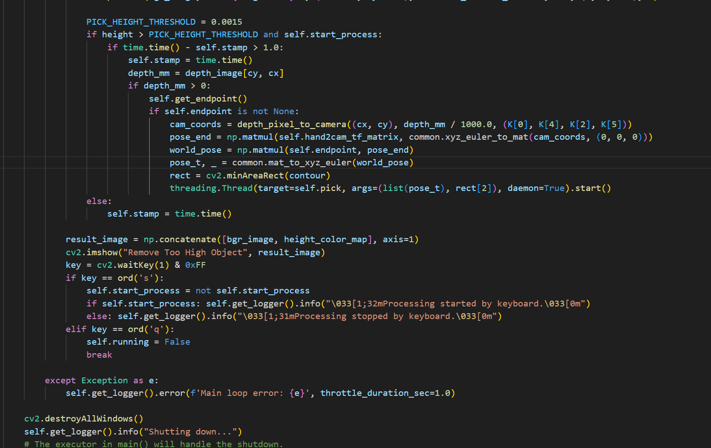

This function retrieves image data from the queue, calculates the height map, detects excessively tall objects whose height exceeds the threshold, and triggers the `pick` thread for gripping. It visualizes results by concatenating RGB images with pseudocolor height maps, supporting keyboard interactions where pressing **S** toggles processing and pressing **Q** exits.

(13) `main` Method

```py
def main():
    node = RemoveTooHighObjectNode('remove_too_high')
    executor = MultiThreadedExecutor()
    try:
        executor.add_node(node)
        executor.spin()
    except KeyboardInterrupt:
        node.get_logger().info("KeyboardInterrupt, exiting...")
    finally:
        try:
            node.destroy_node()
        except Exception:
            pass
```

This method initializes ROS 2, creates a `RemoveTooHighObjectNode` instance, and starts a multi-threaded executor to process callbacks. It catches keyboard interrupts, cleans up node resources, and shuts down ROS.

---

## 8.5 3D Spatial Gripping

### 8.5.1 Introduction

This section focuses on initializing the node and subscribing to RGB and depth image topic information.

Next, image processing is performed to acquire target pixel coordinates and track the target.

Coordinate transformation is applied to convert pixel coordinates into robotic arm world coordinates.

Finally, trajectory planning is executed on the robotic arm to pick up the object and place it at the designated location.

### 8.5.2 Operating Steps

> [!NOTE]
>
> * **Command inputs are case-sensitive. Press the Tab key on the keyboard for keyword auto-completion.**
>
> * **Before powering on the robotic arm, make sure to secure the base to a desktop or stable platform using a G clamp. The robotic arm generates swinging motion and inertia during startup and operation. Failure to secure the base may cause the device to tip over, fall, or sustain damage, posing potential safety hazards.**
>
> * **Refer to [1. Tutorials / 1. NexArm User Manual / 1.9 Object Grasping Adjustment]() to calibrate the robotic arm position beforehand. Failure to calibrate may affect block gripping accuracy.**

1) Start the robotic arm and connect to the remote control software **NoMachine**, with reference to [1. Tutorials / 1. NexArm User Manual / 1.5 Development Environment Setup and Configuration]().

2) Double-click the system desktop icon  to open the command line terminal. Enter the following command and press **Enter** to disable the auto-start service:

```bash
~/.stop_ros.sh
```

3) Enter the command to run the feature program and press **Enter**:

```bash
ros2 launch example track_and_grab.launch.py
```

4) To exit the feature, press **Ctrl+C**. If the shutdown fails, press it multiple times.

### 8.5.3 Program Outcome

After starting the feature, the robotic arm raises the depth camera to look forward, recognizes a color block in mid-air, which defaults to a red block, tracks the block, computes its 3D pose, picks it up, and places it at the designated position.

> [!NOTE]
>
> **Due to the minimum detection range of the depth camera, distances within this blind zone cannot be measured accurately and will be identified as 0. When the display screen prompts "TOO CLOSE !!!", move the target color block further away from the camera to ensure proper gripping.**

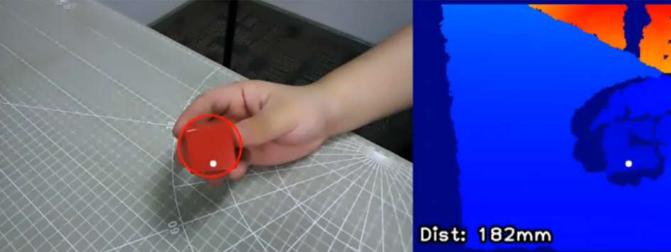

### 8.5.4 Program Analysis

* **Launch File Analysis**

The launch file is located at: **/home/ubuntu/ros2_ws/src/example/example/rgbd_function/track_and_grab.launch.py**

(1) `launch_setup` Function

```py
def launch_setup(context):
    compiled = os.environ.get('need_compile', 'False')

    start = LaunchConfiguration('start', default='true')
    start_arg = DeclareLaunchArgument('start', default_value=start)
    color = LaunchConfiguration('color', default='red')
    color_arg = DeclareLaunchArgument('color', default_value=color)
    if compiled == 'True':
        sdk_package_path = get_package_share_directory('sdk')
        peripherals_package_path = get_package_share_directory('peripherals')
    else:
        sdk_package_path = '/home/ubuntu/ros2_ws/src/driver/sdk'
        peripherals_package_path = '/home/ubuntu/ros2_ws/src/peripherals'

    sdk_launch = IncludeLaunchDescription(
        PythonLaunchDescriptionSource(
            os.path.join(sdk_package_path, 'launch/nexarm.launch.py')),
    )
    depth_camera_launch = IncludeLaunchDescription(
        PythonLaunchDescriptionSource(
            os.path.join(peripherals_package_path, 'launch/depth_camera.launch.py')),
    )

    track_and_grab_node = Node(
        package='example',
        executable='track_and_grab',
        output='screen',
        parameters=[{'color': color}, {'start': start}]
    )

    return [depth_camera_launch,
            sdk_launch,
            track_and_grab_node,
            ]
```

This function loads **launch/nexarm.launch.py** from the **sdk** package to start the NexArm controller communication and servo control nodes, including servo driving and kinematics computation. It loads **launch/depth_camera.launch.py** from the **peripherals** package to start the depth camera node, providing RGB images and depth data as base input for tracking and gripping. It declares `track_and_grab_node` to execute the **track_and_grab** executable from the **example** package to implement color tracking and gripping. It passes `color` and `start` into the node via the `parameters` argument to support dynamic configuration of target tracking color and startup state, outputting logs to the screen.

(2) `generate_launch_description` Function

```py
def generate_launch_description():
    return LaunchDescription([
        OpaqueFunction(function = launch_setup)
    ])
```

This function creates and returns a `LaunchDescription` object. It invokes the `launch_setup` function via `OpaqueFunction`, serving as the standard entry point for ROS 2 launch files.

(3) Main Function

```py
if __name__ == '__main__':
    # Create a launchDescription object
    ld = generate_launch_description()

    ls = LaunchService()
    ls.include_launch_description(ld)
    ls.run()
```

This function creates the `LaunchDescription` object and `LaunchService` service, adds the launch description to the launch service, and executes it to manually start the entire system.

* **Python File Analysis**

The Python file is located at: **/home/ubuntu/ros2_ws/src/example/example/rgbd_function/include/track_and_grab.py**

(1) Importing Packages

```py
import cv2
import math
import time
import rclpy
import queue
import signal
import threading
import numpy as np
import message_filters
from rclpy.node import Node
from std_srvs.srv import SetBool
from sdk import pid, common, fps
from std_srvs.srv import Trigger
from interfaces.srv import SetString
from sensor_msgs.msg import Image, CameraInfo
from rclpy.executors import MultiThreadedExecutor
from servo_controller_msgs.msg import ServosPosition
from rclpy.callback_groups import ReentrantCallbackGroup
from kinematics.kinematics_control import set_pose_target
from kinematics_msgs.srv import GetRobotPose, SetRobotPose
from servo_controller.bus_servo_control import set_servo_position
```

1. **from std_srvs.srv import SetBool**: Import the `SetBool` service type for boolean service requests.

2. **from sdk import pid, common, fps**: Import PID control, common utilities, and frame rate calculation modules from `sdk`.

3. **from servo_controller_msgs.msg import ServosPosition**: Import the `ServosPosition` message type from `servo_controller_msgs` to control servo positions.

4. **from kinematics.kinematics_control import set_pose_target**: Import the `set_pose_target` function from `kinematics` to set target robot poses.

5. **from kinematics_msgs.srv import GetRobotPose, SetRobotPose**: Import `GetRobotPose` and `SetRobotPose` service types from `kinematics_msgs` to retrieve and configure robot poses.

6. **from servo_controller.bus_servo_control import set_servo_position**: Import the `set_servo_position` function from `servo_controller.bus_servo_control` to set servo positions.

(2) `depth_pixel_to_camera` Function

```py
def depth_pixel_to_camera(pixel_coords, depth, intrinsics):
    fx, fy, cx, cy = intrinsics
    px, py = pixel_coords
    x = (px - cx) * depth / fx
    y = (py - cy) * depth / fy
    z = depth
    return np.array([x, y, z])
```

This function converts pixel coordinates in the depth image into 3D point coordinates in the camera coordinate frame.

(3) `ColorTracker` Initialization Function

```py
    def __init__(self, target_color):
        self.target_color = target_color
        self.pid_yaw = pid.PID(20.5, 1.0, 1.2)
        self.pid_pitch = pid.PID(20.5, 1.0, 1.2)
        self.yaw = 500
        self.pitch = 150
```

This function initializes the color tracker, sets the target color, configures PID controllers for pitch and yaw angle adjustments, and sets initial angles.

(4) `proc` Function

```py
    def proc(self, source_image, result_image, color_ranges):
        h, w = source_image.shape[:2]
        color = color_ranges['color_range_list'][self.target_color]

        img = cv2.resize(source_image, (int(w/2), int(h/2)))
        img_blur = cv2.GaussianBlur(img, (3, 3), 3) # Gaussian blur
        img_lab = cv2.cvtColor(img_blur, cv2.COLOR_BGR2LAB) # Convert to LAB space
        mask = cv2.inRange(img_lab, tuple(color['min']), tuple(color['max']))   # Binarization

        # Smooth edges, remove small blocks, merge nearby blocks
        eroded = cv2.erode(mask, cv2.getStructuringElement(cv2.MORPH_RECT, (3, 3)))
        dilated = cv2.dilate(eroded, cv2.getStructuringElement(cv2.MORPH_RECT, (3, 3)))
        # Find the largest contour
        contours = cv2.findContours(dilated, cv2.RETR_EXTERNAL, cv2.CHAIN_APPROX_NONE)[-2]
        min_c = None
        for c in contours:
            if math.fabs(cv2.contourArea(c)) < 50:
                continue
            (center_x, center_y), radius = cv2.minEnclosingCircle(c)  # Minimum enclosing circle
            if min_c is None:
                min_c = (c, center_x)
            elif center_x < min_c[1]:
                if center_x < min_c[1]:
                    min_c = (c, center_x)
        # If there is a contour that meets the requirements
        if min_c is not None:
            (center_x, center_y), radius = cv2.minEnclosingCircle(min_c[0]) # Minimum enclosing circle

            # Circle the identified color block to track
            circle_color = common.range_rgb[self.target_color] if self.target_color in common.range_rgb else (0x55, 0x55, 0x55)
            cv2.circle(result_image, (int(center_x * 2), int(center_y * 2)), int(radius * 2), circle_color, 2)

            center_x = center_x * 2
            center_x_1 = center_x / w
            if abs(center_x_1 - 0.5) > 0.02:  # If the difference is within a certain range, no need to move
                self.pid_yaw.SetPoint = 0.5 # The target is to center the color block in the image, which is the pixel width of 1/2
                self.pid_yaw.update(center_x_1)
                self.yaw = min(max(self.yaw + self.pid_yaw.output, 0), 1000)
            else:
                self.pid_yaw.clear() # If already centered, reset the PID controller

            center_y = center_y * 2
            center_y_1 = center_y / h
            if abs(center_y_1 - 0.5) > 0.02:
                self.pid_pitch.SetPoint = 0.5
                self.pid_pitch.update(center_y_1)
                self.pitch = min(max(self.pitch + self.pid_pitch.output, 100), 720)
            else:
                self.pid_pitch.clear()
            return (result_image, (self.pitch, self.yaw), (center_x, center_y), radius * 2)
        else:
            return (result_image, None, None, 0)
```

This function processes input images by detecting target color blocks in the LAB color space, calculating the center position of the block, adjusting pitch and yaw angles via PID control, and returning the processed image, angle values, center coordinates, and radius.

(5) `TrackAndGrabNode` Initialization Function

```py
class TrackAndGrabNode(Node):
    def __init__(self, name):
        rclpy.init()
        super().__init__(name, allow_undeclared_parameters=True, automatically_declare_parameters_from_overrides=True)
        self.fps = fps.FPS()
        self.moving = False
        self.count = 0
        self.start = False
        self.running = True
        self.last_pitch_yaw = (0, 0)

        self.enable_disp = 1
        signal.signal(signal.SIGINT, self.shutdown)

        # Load LAB color range configuration file
        self.data = common.get_yaml_data("/home/ubuntu/ros2_ws/src/app/config/lab_config.yaml")  
        self.lab_data = self.data['/**']['ros__parameters']
        
        try:
            camera_info_data = common.get_yaml_data("/home/ubuntu/ros2_ws/src/peripherals/config/camera_info.yaml")
            self.hand2cam_tf_matrix = camera_info_data['hand2cam_tf_matrix']
            self.get_logger().info('Hand-eye calibration matrix loaded successfully.')
        except Exception as e:
            self.get_logger().error(f'Failed to load hand-eye calibration matrix: {e}')
            # If loading fails, set identity matrix as backup
            self.hand2cam_tf_matrix = np.identity(4).tolist()
            self.running = False


        self.last_position = (0, 0, 0)
        self.stamp = time.time()

        self.joints_pub = self.create_publisher(ServosPosition, '/servo_controller', 1)

        self.target_color = None
     
        self.get_current_pose_client = self.create_client(GetRobotPose, '/kinematics/get_current_pose')
        self.get_current_pose_client.wait_for_service()
        self.set_pose_target_client = self.create_client(SetRobotPose, '/kinematics/set_pose_target')
        self.set_pose_target_client.wait_for_service()

        self.create_service(Trigger, '~/start', self.start_srv_callback)
        self.create_service(Trigger, '~/stop', self.stop_srv_callback)
        self.create_service(SetString, '~/set_color', self.set_color_srv_callback)
        self.tracker = None

        self.image_queue = queue.Queue(maxsize=2)
        self.endpoint = None

        self.start_stamp = time.time() + 3

        self.client = self.create_client(Trigger, '/controller_manager/init_finish')
        self.client.wait_for_service()

        rgb_sub = message_filters.Subscriber(self, Image, '/depth_cam/rgb/image_raw')
        depth_sub = message_filters.Subscriber(self, Image, '/depth_cam/depth/image_raw')
        info_sub = message_filters.Subscriber(self, CameraInfo, '/depth_cam/depth/camera_info')

        # Synchronize timestamps, allow a time error of 0.02 s
        sync = message_filters.ApproximateTimeSynchronizer([rgb_sub, depth_sub, info_sub], 3, 0.2)
        sync.registerCallback(self.multi_callback) # Execute feedback function
        
        timer_cb_group = ReentrantCallbackGroup()
        self.timer = self.create_timer(0.0, self.init_process, callback_group=timer_cb_group)
```

This method initializes the node, configures operating parameters and ROS communication components, loads color configurations and the hand-eye calibration matrix, subscribes to RGB images, depth images, and camera intrinsics synchronously, and starts the initialization timer.

(6) `init_process` Function

```py
    def init_process(self):
        self.timer.cancel()
        servo_positions = ((6, 500), (5, 600), (4, 825), (3, 110), (2, 500), (1, 300))
        self.get_logger().info('\033[1;36mInit Servo Positions: %s\033[0m' % str(servo_positions))
        set_servo_position(self.joints_pub, 1, servo_positions)
        time.sleep(1)
        if self.get_parameter('start').value:
            self.target_color = self.get_parameter('color').value
            self.get_logger().info('\033[1;35mget_parameter color: %s\033[0m' % self.target_color)   # Print the retrieved color
 
            msg = SetString.Request()
            msg.data = self.target_color
            self.set_color_srv_callback(msg, SetString.Response())

        threading.Thread(target=self.main, daemon=True).start()
        self.create_service(Trigger, '~/init_finish', self.get_node_state)
        self.get_logger().info('\033[1;32m%s\033[0m' % 'start')
```

This function completes node initialization, sets servos to initial positions, launches the main loop thread, creates the initialization completion service, and outputs startup logs.

(7) `get_node_state` Function

```py
    def get_node_state(self, request, response):
        response.success = True
        return response
```

This function serves as the service callback function to return the node initialization success state.

(8) `shutdown` Function

```py
    def shutdown(self, signum, frame):
        self.running = False
```

This function handles interrupt signals, such as **Ctrl+C**, sets the running flag to `False`, and stops the node.

(9) `set_color_srv_callback` Function

```py
    def set_color_srv_callback(self, request, response):
        self.get_logger().info('\033[1;32m%s\033[0m' % "set_color")
        self.target_color = request.data
        self.get_logger().info('\033[1;35mset_color_srv_callback color: %s\033[0m' % self.target_color)  # Print the set color
        self.tracker = ColorTracker(self.target_color)
        self.get_logger().info('\033[1;32mset color: %s\033[0m' % self.target_color)
        self.start = True
        response.success = True
        response.message = "set_color"
        return response
```

This service callback function sets the target tracking color, initializes the color tracker, and returns a success response.

(10) `start_srv_callback` and `stop_srv_callback` Functions

```py
    def start_srv_callback(self, request, response):
        self.get_logger().info('\033[1;32m%s\033[0m' % "start")
        self.start = True
        response.success = True
        response.message = "start"
        return response

    def stop_srv_callback(self, request, response):
        self.get_logger().info('\033[1;32m%s\033[0m' % "stop")
        self.start = False
        self.moving = False
        self.count = 0
        self.last_pitch_yaw = (0, 0)
        self.last_position = (0, 0, 0)
        servo_positions = ((6, 500), (5, 600), (4, 825), (3, 110), (2, 500), (1, 210))
        self.get_logger().info('\033[1;36mStop Servo Positions: %s\033[0m' % str(servo_positions))
        set_servo_position(self.joints_pub, 1, servo_positions)
        response.success = True
        response.message = "stop"
        return response
```

The `start_srv_callback` function starts tracking and gripping features, returning a success response. The `stop_srv_callback` function stops the feature, resets servos to initial positions, and returns a success response.

(11) `send_request` Function

```py
    def send_request(self, client, msg):
        future = client.call_async(msg)
        while rclpy.ok():
            if future.done() and future.result():
                return future.result()
```

This function sends service requests and blocks until the result returns, ensuring service communication completes.

(12) `multi_callback` Function

```py
    def multi_callback(self, ros_rgb_image, ros_depth_image, depth_camera_info):
        if self.image_queue.full():
            # If the queue is full, discard the oldest image
            self.image_queue.get()
        # Put the image in the queue
        self.image_queue.put((ros_rgb_image, ros_depth_image, depth_camera_info))
```

This function synchronously receives RGB images, depth images, and camera intrinsics, placing them into a thread-safe queue for main loop processing.

(13) `get_endpoint` Function

```py
    def get_endpoint(self):
        endpoint = self.send_request(self.get_current_pose_client, GetRobotPose.Request()).pose
        self.endpoint = common.xyz_quat_to_mat([endpoint.position.x, endpoint.position.y, endpoint.position.z],
                                        [endpoint.orientation.w, endpoint.orientation.x, endpoint.orientation.y, endpoint.orientation.z])
        return self.endpoint
```

This function retrieves the current end-effector pose of the robotic arm and converts it into a 4 × 4 transformation matrix for coordinate transformation.

(14) `pick` Function

```py
    def pick(self, position):
        if position[2] < 0.2:
            yaw = 80
        else:
            yaw = 30
        msg = set_pose_target(position, yaw, [-180.0, 180.0], 1.0)
        res = self.send_request(self.set_pose_target_client, msg)
        if res.pulse:
            servo_data = res.pulse
            servo_positions = ((6, servo_data[0]),)
            self.get_logger().info('\033[1;36mPick Servo Positions 1: %s\033[0m' % str(servo_positions))
            set_servo_position(self.joints_pub, 1, servo_positions)
            time.sleep(1)
            servo_positions = ((6, servo_data[0]),(5, servo_data[1]), (4, servo_data[2]),(3, servo_data[3]), (2, servo_data[4]))
            self.get_logger().info('\033[1;36mPick Servo Positions 2: %s\033[0m' % str(servo_positions))
            set_servo_position(self.joints_pub, 1.5, servo_positions)
            time.sleep(1.5)

            servo_positions = ((1, 600),)
            self.get_logger().info('\033[1;36mPick Servo Positions 3: %s\033[0m' % str(servo_positions))
            set_servo_position(self.joints_pub, 0.5, servo_positions)
            time.sleep(1)

            position[2] += 0.06
            msg = set_pose_target(position, yaw, [-180.0, 180.0], 1.0)
            res = self.send_request(self.set_pose_target_client, msg)
            if res.pulse:
                servo_data = res.pulse
                servo_positions = ((6, servo_data[0]),(5, servo_data[1]), (4, servo_data[2]),(3, servo_data[3]), (2, servo_data[4]))
                self.get_logger().info('\033[1;36mPick Servo Positions 4: %s\033[0m' % str(servo_positions))
                set_servo_position(self.joints_pub, 1, servo_positions)
                time.sleep(1)


            servo_positions = ((6, 500), (5, 720), (4, 900), (3, 120), (2, 500), (1, 500))
            self.get_logger().info('\033[1;36mPick Servo Positions 5: %s\033[0m' % str(servo_positions))
            set_servo_position(self.joints_pub, 1, servo_positions)
            time.sleep(1)
            servo_positions = ((6, 125), (5, 635), (4, 780), (3, 200), (2, 500))
            self.get_logger().info('\033[1;36mPick Servo Positions 6: %s\033[0m' % str(servo_positions))
            set_servo_position(self.joints_pub, 1, servo_positions)
            time.sleep(1)
            servo_positions = ((6, 125), (5,550), (4, 780), (3, 150), (2, 500))
            self.get_logger().info('\033[1;36mPick Servo Positions 7: %s\033[0m' % str(servo_positions))
            set_servo_position(self.joints_pub, 1.5, servo_positions)
            time.sleep(1.5)
            servo_positions = ((6, 125), (5, 550), (4, 780), (3, 170), (2, 500), (1, 200))
            self.get_logger().info('\033[1;36mPick Servo Positions 8: %s\033[0m' % str(servo_positions))
            set_servo_position(self.joints_pub, 1, servo_positions)
            time.sleep(1.5)
            servo_positions = ((6, 500), (5, 720), (4, 900), (3, 250), (2, 500), (1, 200))
            self.get_logger().info('\033[1;36mPick Servo Positions 9: %s\033[0m' % str(servo_positions))
            set_servo_position(self.joints_pub, 1, servo_positions)
            time.sleep(2)
            self.tracker.yaw = 500
            self.tracker.pitch = 150
            self.tracker.pid_yaw.clear()
            self.tracker.pid_pitch.clear()
            self.stamp = time.time()
        else:
            self.tracker.yaw = 500
            self.tracker.pitch = 150
            self.tracker.pid_yaw.clear()
            self.tracker.pid_pitch.clear()
            self.stamp = time.time()
            self.get_logger().info('\033[1;31m%s\033[0m' % "Out of gripping range")
        self.moving = False
```

This method implements robotic arm gripping logic, controlling servos to move to the target position, pick up the object, lift it, place it at the designated destination, and reset to the home position.

(15) `main` Method

```py
    def main(self):
        while self.running:
            try:
                ros_rgb_image, ros_depth_image, depth_camera_info = self.image_queue.get(block=True, timeout=1)
            except queue.Empty:
                if not self.running:
                    break
                else:
                    continue
            try:
                rgb_image = np.ndarray(shape=(ros_rgb_image.height, ros_rgb_image.width, 3), dtype=np.uint8, buffer=ros_rgb_image.data)
                depth_image = np.ndarray(shape=(ros_depth_image.height, ros_depth_image.width), dtype=np.uint16, buffer=ros_depth_image.data)
                result_image = np.copy(rgb_image)

                h, w = depth_image.shape[:2]
                depth = np.copy(depth_image).reshape((-1, ))
                depth[depth<=0] = 55555

                sim_depth_image = np.clip(depth_image, 0, 2000).astype(np.float64)

                sim_depth_image = sim_depth_image / 2000.0 * 255.0
                bgr_image = cv2.cvtColor(rgb_image, cv2.COLOR_RGB2BGR)

                depth_color_map = cv2.applyColorMap(sim_depth_image.astype(np.uint8), cv2.COLORMAP_JET)

                if self.tracker is not None and self.moving == False and time.time() > self.start_stamp and self.start:
                    result_image, p_y, center, r = self.tracker.proc(rgb_image, result_image, self.lab_data)
                    if p_y is not None:
                        servo_positions = ((6, int(p_y[1])), (4, (1000-int(p_y[0]))))
                        self.get_logger().info('\033[1;36mTracker Servo Positions: %s\033[0m' % str(servo_positions))
                        set_servo_position(self.joints_pub, 0.02, servo_positions)
                        center_x, center_y = center
                        if center_x > w:
                            center_x = w
                        if center_y > h:
                            center_y = h
                        if abs(self.last_pitch_yaw[0] - p_y[0]) < 3 and abs(self.last_pitch_yaw[1] - p_y[1]) < 3:
                            if time.time() - self.stamp > 2:
                                self.stamp = time.time()
                                roi = [int(center_y) - 5, int(center_y) + 5, int(center_x) - 5, int(center_x) + 5]
                                roi[0] = max(0, roi[0])
                                roi[1] = min(h, roi[1])
                                roi[2] = max(0, roi[2])
                                roi[3] = min(w, roi[3])

                                roi_distance = depth_image[roi[0]:roi[1], roi[2]:roi[3]]
                                valid_depths = roi_distance[np.logical_and(roi_distance > 0, roi_distance < 10000)]

                                if valid_depths.size == 0:
                                    self.get_logger().warn("No valid depth data in ROI. Skipping calculation.")
                                    dist = 0.20  # Or set a default value, such as dist = 0.15
                                else:
                                    dist = round(float(np.mean(valid_depths) / 1000.0), 3)

                                self.get_logger().info("DISTANCE: " + str(dist))
                                # dist += 0.015 # Object radius compensation
                                # dist += 0.015 # Error compensation
                                K = depth_camera_info.k
                                self.get_endpoint()
                                position = depth_pixel_to_camera((center_x, center_y), dist, (K[0], K[4], K[2], K[5]))
                                
                                position[0] -= 0.01  # There is a 1 cm offset between the RGB camera and the depth camera
                                pose_end = np.matmul(self.hand2cam_tf_matrix, common.xyz_euler_to_mat(position, (0, 0, 0)))  # Converted end-effector relative coordinates
                                world_pose = np.matmul(self.endpoint, pose_end)  # Transform to the robotic arm world coordinates
                                pose_t, pose_R = common.mat_to_xyz_euler(world_pose)
                                self.stamp = time.time()
                                self.moving = True
                                threading.Thread(target=self.pick, args=(pose_t,)).start()
                        else:
                            self.stamp = time.time()
                        dist = depth_image[int(center_y),int(center_x)]
                        if dist < 200:
                            txt = "TOO CLOSE !!!"
                        else:
                            txt = "Dist: {}mm".format(dist)
                        cv2.circle(result_image, (int(center_x), int(center_y)), 5, (255, 255, 255), -1)
                        cv2.circle(depth_color_map, (int(center_x), int(center_y)), 5, (255, 255, 255), -1)
                        cv2.putText(depth_color_map, txt, (10, 400 - 20), cv2.FONT_HERSHEY_PLAIN, 2.0, (0, 0, 0), 10, cv2.LINE_AA)
                        cv2.putText(depth_color_map, txt, (10, 400 - 20), cv2.FONT_HERSHEY_PLAIN, 2.0, (255, 255, 255), 2, cv2.LINE_AA)
                        self.last_pitch_yaw = p_y
                    else:
                        self.stamp = time.time()
                if self.enable_disp:
                    #result_image = cv2.cvtColor(result_image[40:440, ], cv2.COLOR_RGB2BGR)
                    result_image = result_image
                    result_image = np.concatenate([result_image, depth_color_map], axis=1)
                    cv2.imshow("depth", result_image)
                    key = cv2.waitKey(1)
                    if key == ord('q') or key == 27:  # Press 'q' or 'Esc' to exit
                        self.running = False

            except Exception as e:
                self.get_logger().info('error1: ' + str(e))
        rclpy.shutdown()
```

This function serves as the node entry point to initialize ROS, create the node instance, start a multi-threaded executor to process callbacks, catch interrupts, and clean up resources.

---

## 8.6 3D Shape Sorting

### 8.6.1 Introduction

This section focuses on initializing the node and retrieving topic information for RGB and depth images.

Next, image processing is conducted to identify object shapes in the field of view based on the number of detected contour corners.

Pixel coordinates of the tallest object within the field of view are extracted and converted into robotic arm world coordinates.

Finally, trajectory planning is performed to control the robotic arm to grasp objects and sort them into designated locations.

### 8.6.2 Operating Steps

> [!NOTE]
>
> * **Command inputs are case-sensitive. Press the Tab key on the keyboard for keyword auto-completion.**
>
> * **Before powering on the robotic arm, make sure to secure the base to a desktop or stable platform using a G clamp. The robotic arm generates swinging motion and inertia during startup and operation. Failure to secure the base may cause the device to tip over, fall, or sustain damage, posing potential safety hazards.**
>
> * **Refer to [1. Tutorials / 1. NexArm User Manual / 1.9 Object Grasping Adjustment]() to calibrate the robotic arm position beforehand. Failure to calibrate may affect block gripping accuracy.**

1) Start the robotic arm and connect to the remote control software **NoMachine**, with reference to [1. Tutorials / 1. NexArm User Manual / 1.5 Development Environment Setup and Configuration]().

2) Double-click the system desktop icon  to open the command line terminal. Enter the following command and press **Enter** to disable the auto-start service:

```bash
~/.stop_ros.sh
```

3) Enter the command to run the feature program and press **Enter**:

```bash
ros2 launch example shape_recognition.launch.py
```

4) Once the feature starts, the robotic arm streams both the RGB color image and depth image onto the screen.

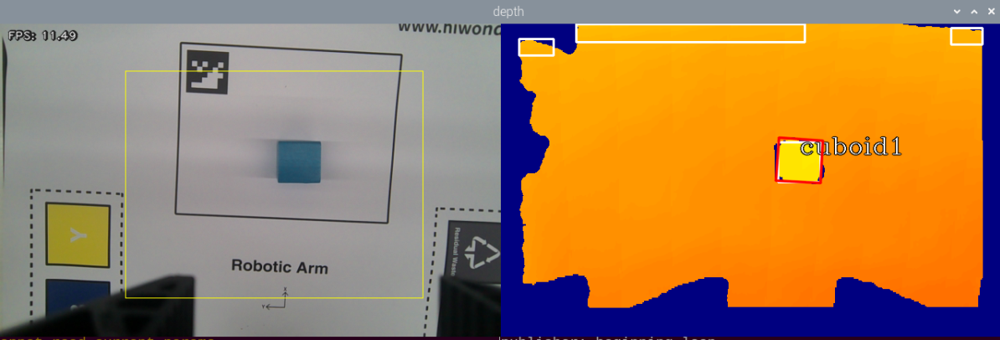

5) To exit the feature, press **Ctrl+C**. If the shutdown fails, press it multiple times.

### 8.6.3 Program Outcome

After launching the feature, the robotic arm identifies cuboids, cylinders, and spheres within its field of view, picks them up, and classifies them into corresponding locations.

### 8.6.4 Program Analysis

* **Launch File Analysis**

The launch file is located at: **/home/ubuntu/ros2_ws/src/example/example/rgbd_function/shape_recognition.launch.py**

(1) `launch_setup` Function

```py
def launch_setup(context):
    compiled = os.environ.get('need_compile', 'False')
    start = LaunchConfiguration('start', default='true')
    start_arg = DeclareLaunchArgument('start', default_value=start)
    display = LaunchConfiguration('display', default='true')
    display_arg = DeclareLaunchArgument('display', default_value=display)

    if compiled == 'True':
        sdk_package_path = get_package_share_directory('sdk')
        peripherals_package_path = get_package_share_directory('peripherals')
    else:
        sdk_package_path = '/home/ubuntu/ros2_ws/src/driver/sdk'
        peripherals_package_path = '/home/ubuntu/ros2_ws/src/peripherals'

    sdk_launch = IncludeLaunchDescription(
        PythonLaunchDescriptionSource(
            os.path.join(sdk_package_path, 'launch/nexarm.launch.py')),
    )
    depth_camera_launch = IncludeLaunchDescription(
        PythonLaunchDescriptionSource(
            os.path.join(peripherals_package_path, 'launch/depth_camera.launch.py')),
    )

    shape_recognition_node = Node(
        package='example',
        executable='shape_recognition',
        output='screen',
        parameters=[{'start': start, 'display': display}],
    )

    return [start_arg,
            display_arg,
            depth_camera_launch,
            sdk_launch,
            shape_recognition_node,
            ]
```

This function loads **launch/nexarm.launch.py** from the **sdk** package to start the NexArm controller communication and servo control nodes, including servo driving and kinematics computation. It loads **launch/depth_camera.launch.py** from the **peripherals** package to start the depth camera node, providing RGB images and depth data as base input for shape recognition. It declares `shape_recognition_node` to execute the **shape_recognition** executable from the **app** package to implement shape recognition. It passes `start` and `display` into the node via `parameters` to dynamically control execution and visualization switches, outputting logs to the screen.

(2) `generate_launch_description` Function

```py
def generate_launch_description():
    return LaunchDescription([
        OpaqueFunction(function = launch_setup)
    ])
```

This function creates and returns a `LaunchDescription` object. It invokes the `launch_setup` function via `OpaqueFunction`, serving as the standard entry point for ROS 2 launch files.

(3) Main Function

```py
if __name__ == '__main__':
    # Create a launchDescription object
    ld = generate_launch_description()

    ls = LaunchService()
    ls.include_launch_description(ld)
    ls.run()
```

This function creates the `LaunchDescription` object and `LaunchService` service, adds the launch description to the launch service, and executes it to manually start the entire system.

* **Python File Analysis**

The Python file is located at: **/home/ubuntu/ros2_ws/src/example/example/rgbd_function/include/shape_recognition.py**

(1) Importing Packages

```py
import os
import cv2
import time
import math
import rclpy
import queue
import signal
import threading
import numpy as np
import message_filters
from rclpy.node import Node
from sdk import common, fps
from interfaces.srv import SetStringList
from std_srvs.srv import Trigger, SetBool

from sensor_msgs.msg import Image, CameraInfo
from rclpy.executors import MultiThreadedExecutor
from ros_robot_controller_msgs.msg import ArmCoords, BuzzerState, ArmFullState
from example.scene_pose import load_scene_home_pose
from ros_robot_controller_msgs.srv import GetArmFullState
from rclpy.callback_groups import ReentrantCallbackGroup
from example.rgbd_function.include.grasp_height import side_grasp_z_from_top
from example.rgbd_function.include.position_change_detect import position_reorder

```

1. **from sdk import common, fps**: Imports the general-purpose module `common` and the frame rate counter module `fps` from the SDK for general operations and performance analysis.

2. **from ros_robot_controller_msgs.msg import ArmCoords, BuzzerState, ArmFullState**: Imports messages for NexArm coordinate control, buzzer state, and arm full state.

3. **from example.scene_pose import load_scene_home_pose**: Reads the robotic arm initial pose from the current scene configuration, adapting the example to the calibrated NexArm coordinates.

4. **from ros_robot_controller_msgs.srv import GetArmFullState**: Retrieves the real-time full state of the robotic arm to synchronize the current end-effector pose.

5. **from rclpy.callback_groups import ReentrantCallbackGroup**: Creates a reentrant callback group to work with a multi-threaded executor for handling initialization and service callbacks.

6. **from example.rgbd_function.include.grasp_height import side_grasp_z_from_top**: Calculates the side grasping height based on the top surface height of the target.

7. **from example.rgbd_function.include.position_change_detect import position_reorder**: Imports the `position_reorder` function to reorder detected positions.

(2) `depth_pixel_to_camera` Function

```py
def depth_pixel_to_camera(pixel_coords, intrinsic_matrix):
    fx, fy, cx, cy = intrinsic_matrix[0], intrinsic_matrix[4], intrinsic_matrix[2], intrinsic_matrix[5]
    px, py, pz = pixel_coords
    x = (px - cx) * pz / fx
    y = (py - cy) * pz / fy
    z = pz
    return np.array([x, y, z])
```

This function converts pixel coordinates with depth values from the depth image into 3D coordinates in the camera coordinate frame using the camera intrinsic matrix.

(3) `ObjectClassificationNode` Initialization Function

```py
    def __init__(self, name):
        super().__init__(name, allow_undeclared_parameters=True, automatically_declare_parameters_from_overrides=True)
        self.fps = fps.FPS()
        self.moving = False
        self.count = 0
        self.running = True
        self.start = self.get_bool_param('start', False)
        self.display = self.get_bool_param('display', True)
        self.shapes = None
        self.target_shapes = None
        self.roi = [60, 380, 160, 560]
        self.endpoint = None
        self.last_position = (0.0, 0.0)
        self.last_object_info_list = []
        self.current_pose = None
        signal.signal(signal.SIGINT, self.shutdown)
        self.image_queue = queue.Queue(maxsize=2)
        self.arm_pub = self.create_publisher(ArmCoords, '/ros_robot_controller/arm/set_coords', 5)
        self.buzzer_pub = self.create_publisher(BuzzerState, '/ros_robot_controller/set_buzzer', 1)
        self.arm_state_sub = self.create_subscription(ArmFullState, '/ros_robot_controller/arm/state', self.arm_state_callback, 10)
        self.get_arm_state_client = self.create_client(GetArmFullState, '/ros_robot_controller/arm/get_state')

        self.create_service(Trigger, '~/start', self.start_srv_callback)
        self.create_service(Trigger, '~/stop', self.stop_srv_callback)
        self.create_service(SetStringList, '~/set_shape', self.set_shape_srv_callback)
        
        rgb_sub = message_filters.Subscriber(self, Image, '/depth_cam/rgb/image_raw')
        depth_sub = message_filters.Subscriber(self, Image, '/depth_cam/depth/image_raw')
        info_sub = message_filters.Subscriber(self, CameraInfo, '/depth_cam/depth/camera_info')

        # Synchronize timestamps, allow a time error of 0.03s
        sync = message_filters.ApproximateTimeSynchronizer([rgb_sub, depth_sub, info_sub], 3, 0.2)
        sync.registerCallback(self.multi_callback)
        self.controller_init_client = self.create_client(Trigger, '/controller_manager/init_finish')
        self.kinematics_init_client = self.create_client(Trigger, '/kinematics/init_finish')
```

It initializes the node, reads the `start` and `display` parameters, and creates the `ArmCoords` coordinate control publisher, buzzer publisher, robotic arm state subscriber, and state query service client. It also synchronously subscribes to RGB images, depth images, and camera intrinsic parameters to prepare for subsequent target recognition, coordinate conversion, and grasping actions.

(4) `init_process` Function

```py
    def init_process(self):
        self.timer.cancel()

        msg = SetBool.Request()
        msg.data = False
        #self.send_request(self.client, msg)

        self.goto_default()

        msg = SetStringList.Request()
        msg.data = ['sphere', 'cuboid', 'cylinder']
        self.set_shape_srv_callback(msg, SetStringList.Response())


        threading.Thread(target=self.main, daemon=True).start()
        self.create_service(Trigger, '~/init_finish', self.get_node_state)
        self.get_logger().info('\033[1;32m%s\033[0m' % 'start')
```

This function completes node initialization, moves the robotic arm to its default position, starts the main loop thread, creates the initialization completion service, and outputs startup logs.

(5) `get_node_state` Function

```py
    def get_node_state(self, request, response):
        response.success = True
        return response
```

This function serves as the service callback function to return the node initialization success state.

(6) `shutdown` Function

```py
    def shutdown(self, signum, frame):
        self.running = False
```

This function handles interrupt signals, such as **Ctrl+C**, sets the running flag to `False`, and stops the node.

(7) `send_request` Function

```py
    def send_request(self, client, msg):
        future = client.call_async(msg)
        while rclpy.ok():
            if future.done() and future.result():
                return future.result()
```

This function sends service requests and blocks until the result returns, ensuring complete communication.

(8) `set_shape_srv_callback` Function

```py
    def set_shape_srv_callback(self, request, response):
        self.get_logger().info('\033[1;32m%s\033[0m' % "set_shape")
        # self.colors = None
        self.shapes = request.data
        self.start = True
        response.success = True
        response.message = "set_shape"
        return response
```

This service callback function sets target shapes for recognition, such as spheres or cuboids, initiates recognition processing, and returns a success response.

(9) `start_srv_callback` and `stop_srv_callback` Functions

```py
    def start_srv_callback(self, request, response):
        self.get_logger().info('\033[1;32m%s\033[0m' % "start")
        self.start = True
        response.success = True
        response.message = "start"
        return response

    def stop_srv_callback(self, request, response):
        self.get_logger().info('\033[1;32m%s\033[0m' % "stop")
        self.start = False
        # self.colors = None
        
        self.shapes = None
        self.moving = False
        self.count = 0
        self.target_shapes = ''
        self.last_position = 0, 0
        self.last_object_info_list = []
        response.success = True
        response.message = "stop"
        return response
```

The `start_srv_callback` function starts shape recognition and gripping, returning a success response. The `stop_srv_callback` function stops the feature, resets robotic arm states and recognition parameters, and returns a success response.

(10) `goto_default` Function

```py
    def goto_default(self):
        msg = set_joint_value_target([500, 600, 825, 110, 500])

        endpoint = self.send_request(self.set_joint_value_target_client, msg)
        pose_t = endpoint.pose.position
        pose_r = endpoint.pose.orientation
        set_servo_position(self.joints_pub, 1, ((5, 600), (4, 780), (3, 110), (2, 500)))
        time.sleep(1)

        set_servo_position(self.joints_pub, 1, ((6, 500),))
        time.sleep(1)

        set_servo_position(self.joints_pub, 0.5, ((1, 210),))
        time.sleep(0.5)

        self.endpoint = common.xyz_quat_to_mat([pose_t.x, pose_t.y, pose_t.z], [pose_r.w, pose_r.x, pose_r.y, pose_r.z])
```

This method moves the robotic arm to its default initial position and adjusts each servo angle accordingly.

(11) `move` Function

```py
    def move(self, obejct_info):
        shape, pose_t = obejct_info[:2]
        self.get_logger().info('\033[1;32m%s\033[0m' % pose_t)
        angle = obejct_info[-1]
        msg = BuzzerState()
        msg.freq = 1900
        msg.on_time = 0.2
        msg.off_time = 0.01
        msg.repeat = 1
        self.buzzer_pub.publish(msg)
        time.sleep(1)
        if 'sphere' in shape:
            offset_z =  self.pick_offset[-1]
        elif 'cylinder' in shape:
            offset_z = 0.03 + self.pick_offset[-1]
        else:
            offset_z = 0.02 + self.pick_offset[-1]
        if pose_t[0] > 0.21:
            offset_x = self.pick_offset[0]
        else:
            offset_x = self.pick_offset[1]
        if pose_t[1] > 0:
            offset_y = self.pick_offset[2]
        else:
            offset_y = self.pick_offset[3]
        pose_t[0] += offset_x
        pose_t[1] += offset_y
        pose_t[2] += offset_z
        msg = kinematics_control.set_pose_target(pose_t, 85)
        res1 = self.send_request(self.kinematics_client, msg)
        if res1.pulse:
            servo_data = res1.pulse
            set_servo_position(self.joints_pub, 1.5, ((6, servo_data[0]), (5, servo_data[1]), (4, servo_data[2]), (3, servo_data[3]), (2, servo_data[4])))
            time.sleep(1.5)
        pose_t[2] -= 0.05
        msg = kinematics_control.set_pose_target(pose_t, 85)
        res2 = self.send_request(self.kinematics_client, msg)
        if angle != 0:
            if 'sphere' in shape or ('cylinder' in shape and 'cylinder_horizontal_' not in shape):
                angle = 500
            else:
                angle = angle % 180
                angle = angle - 180 if angle > 90 else (angle + 180 if angle < -90 else angle)
                
                angle = 500 + int(1000 * (angle + res2.rpy[-1]) / 240)
        else:
            angle = 500
        if res2.pulse:
            servo_data = res2.pulse
            set_servo_position(self.joints_pub, 0.5, ((2, angle),))
            time.sleep(0.5)
            set_servo_position(self.joints_pub, 1, ((6, servo_data[0]), (5, servo_data[1]), (4, servo_data[2]), (3, servo_data[3]), (2, angle)))
            time.sleep(1)
            set_servo_position(self.joints_pub, 0.6, ((1, 600),))
            time.sleep(0.6)
        if res1.pulse:
            servo_data = res1.pulse
            set_servo_position(self.joints_pub, 1, ((6, servo_data[0]), (5, servo_data[1]), (4, servo_data[2]), (3, servo_data[3]), (2, angle)))
            time.sleep(1)
        set_servo_position(self.joints_pub, 1, ((6, 500), (5, 600), (4, 780), (3, 110), (2, 500), (1, 210)))
        time.sleep(1)
        # if self.colors is None:
        self.get_logger().info('shape: %s' % shape.split("_")[0])
        if "sphere" in shape:
            self.controller.run_action("target_1")
        if "cylinder" in shape:
            self.controller.run_action("target_2")
        if "cuboid" in shape:
            self.controller.run_action("target_3")
        set_servo_position(self.joints_pub, 1, ((6, 500), (5, 600), (4, 780), (3, 110), (2, 500), (1, 210)))
        time.sleep(1)
        self.moving = False
```

This method executes robotic arm gripping logic by adjusting pick offsets according to object information, including shape, position, and orientation angle, controlling servos to grasp the target, placing it in the corresponding sorting area, and returning to the home position.

(12) `multi_callback` Function

```py
    def multi_callback(self, ros_rgb_image, ros_depth_image, depth_camera_info):
        if self.image_queue.full():
            # If the queue is full, discard the oldest image
            self.image_queue.get()
        # Put the image in the queue
        self.image_queue.put((ros_rgb_image, ros_depth_image, depth_camera_info))
```

This function synchronously receives RGB images, depth images, and camera intrinsics, storing them in a thread-safe queue for main loop processing.

(13) `cal_position` Function

```py
    def cal_position(self, x, y, depth, intrinsic_matrix):
        position = depth_pixel_to_camera([x, y, depth / 1000], intrinsic_matrix)

        pose_end = np.matmul(self.hand2cam_tf_matrix, common.xyz_euler_to_mat(position, (0, 0, 0)))
        world_pose = np.matmul(self.endpoint, pose_end)
        pose_t, pose_r = common.mat_to_xyz_euler(world_pose)
        return pose_t
```

This function transforms object coordinates from the camera coordinate frame into the robotic arm world coordinate frame by combining the hand-eye calibration matrix with the robotic arm end-effector pose.

(14) `get_min_distance` Function

```py
    def get_min_distance(self, depth_image):
        ih, iw = depth_image.shape[:2]
        # Mask some areas, reduce the recognition conditions, and make recognition more reliable
        depth_image[:, :self.roi[2]] = np.array([[1000, ] * self.roi[2]] * ih)
        depth_image[:, self.roi[3]:] = np.array([[1000, ] * (iw - self.roi[3])] * ih)
        depth_image[self.roi[1]:, :] = np.array([[1000, ] * iw] * (ih - self.roi[1]))
        depth_image[:self.roi[0], :] = np.array([[1000, ] * iw] * self.roi[0])
        depth = np.copy(depth_image).reshape((-1,))
        depth[depth <= 0] = 55555  # Distance of 0 might be in the dead zone, assign a large value

        min_index = np.argmin(depth)  # Distance smallest pixel
        min_y = min_index // iw
        min_x = min_index - min_y * iw

        min_dist = depth_image[min_y, min_x]   # Get the distance of the closest object to the camera
        return min_dist
```

This function extracts the minimum distance to the closest object from the ROI region of the depth image while filtering out invalid depth values.

(15) `get_contours` Function

```py
    def get_contours(self, depth_image, min_dist):
        depth_image = np.where(depth_image > 210, 0, depth_image)  
        depth_image = np.where(depth_image > min_dist + 20, 0, depth_image)   # Set pixels with depth value greater than minimum distance + 15 mm to 0
        sim_depth_image_sort = np.clip(depth_image, 0, min_dist - 10).astype(np.float64) / (min_dist - 10) * 255
        depth_gray = sim_depth_image_sort.astype(np.uint8)
        _, depth_bit = cv2.threshold(depth_gray, 1, 255, cv2.THRESH_BINARY)
        contours, hierarchy = cv2.findContours(depth_bit, cv2.RETR_EXTERNAL, cv2.CHAIN_APPROX_NONE)
        return contours
```

This function extracts object contours from the depth image and minimum distance through threshold filtering and binarization.

(16) `shape_recognition` Function

```py
    def shape_recognition(self, rgb_image, depth_image, depth_color_map, intrinsic_matrix, min_dist):
        object_info_list = []
        image_height, image_width = depth_image.shape[:2]
        self.get_logger().info('\033[1;32m%s\033[0m' % str(min_dist))
        if min_dist <= 270:  # If greater than this value, it indicates below the table, possible detection error, do not recognize
            sphere_index = 0
            cuboid_index = 0
            cylinder_index = 0
            cylinder_horizontal_index = 0
            contours = self.get_contours(depth_image, min_dist)
            
            for obj in contours:
                area = cv2.contourArea(obj)
                if area < 300:
                    continue
                perimeter = cv2.arcLength(obj, True)  # Calculate contour perimeter
                approx = cv2.approxPolyDP(obj, 0.035 * perimeter, True)  # Get contour corner coordinates

                CornerNum = len(approx)
                (cx, cy), r = cv2.minEnclosingCircle(obj)
                center, (width, height), angle = cv2.minAreaRect(obj)
                if angle < -45:
                    angle += 89
                if width > height and width / height > 1.5:
                    angle = angle + 90
                depth = depth_image[int(cy), int(cx)]
                position = self.cal_position(cx, cy, depth, intrinsic_matrix)
                x, y, w, h = cv2.boundingRect(approx)
                mask = np.full((image_height, image_width), 0, dtype=np.uint8)
                
                cv2.drawContours(mask, [obj], -1, (255), cv2.FILLED)
                
                # Calculate the standard deviation of pixel values in the contour region
                depth_image_mask = np.where(depth_image == 0, np.nan, depth_image)
                depth_std = np.nanstd(mask)
                self.get_logger().info('\033[1;32m%s\033[0m' % 'depth_std: ' + str(depth_std))
                self.get_logger().info('\033[1;32m%s\033[0m' % 'CornerNum ' + str(CornerNum))
                objType = None
                if depth_std > 50.0 and CornerNum > 4:
                    sphere_index += 1
                    angle = 0
                    objType = 'sphere_' + str(sphere_index)
                elif depth_std > 35.0:
                    cuboid_index += 1
                    objType = "cuboid_" + str(cuboid_index)

                elif depth_std > 40.0:
                    if abs(width/height - 1) < 0.2:
                        cuboid_index += 1
                        objType = "cuboid_" + str(cuboid_index)
                    else:
                        cylinder_horizontal_index += 1
                        objType = "cylinder_horizontal_" + str(cylinder_horizontal_index)

 
                if depth_std < 35.0 and CornerNum > 4:
                    cylinder_index += 1
                    angle = 0
                    objType = "cylinder_" + str(cylinder_index)
                if objType is not None:
                    object_info_list.append([objType, position, depth, [x, y, w, h, center, width, height], rgb_image[int(center[1]), int(center[0])], angle])
                    cv2.rectangle(depth_color_map, (x, y), (x + w, y + h), (255, 255, 255), 2)
        return object_info_list
```

This function recognizes object shapes, including spheres, cuboids, and cylinders, calculates object positions and angles, returns a list containing object details, and marks contours on the image.

(17) `main` Function

```py
    def main(self):
        count = 0
        while self.running:
            try:
                ros_rgb_image, ros_depth_image, depth_camera_info = self.image_queue.get(block=True, timeout=1)
            except queue.Empty:
                if not self.running:
                    break
                else:
                    continue
            try:
                rgb_image = np.ndarray(shape=(ros_rgb_image.height, ros_rgb_image.width, 3), dtype=np.uint8, buffer=ros_rgb_image.data)
                depth_image = np.ndarray(shape=(ros_depth_image.height, ros_depth_image.width), dtype=np.uint16, buffer=ros_depth_image.data)
                depth_image = depth_image.copy()
                min_dist = self.get_min_distance(depth_image)
                if self.debug:
                    count += 1
                    # self.get_logger().info(str(min_dist))
                    if count > 30:
                        count = 0

                        msg = BuzzerState()
                        msg.freq = 1900
                        msg.on_time = 0.2
                        msg.off_time = 0.01
                        msg.repeat = 1
                        self.buzzer_pub.publish(msg)
                        self.debug = False
                else:
                    # Limit and normalize depth image pixel values to 0 to 255 within 0 to 350 range
                    sim_depth_image = np.clip(depth_image, 0, 350).astype(np.float64) / 350 * 255
                    
                    depth_color_map = cv2.applyColorMap(sim_depth_image.astype(np.uint8), cv2.COLORMAP_JET)
                    if not self.moving:
                        object_info_list = self.shape_recognition(rgb_image, depth_image, depth_color_map, depth_camera_info.k, min_dist)
                        if self.start:
                            reorder_object_info_list = object_info_list
                            if object_info_list:
                                if self.last_object_info_list:
                                    # Compare the position of the object last time and reorder
                                    reorder_object_info_list = position_reorder(object_info_list, self.last_object_info_list, 20)
                            if reorder_object_info_list:
                                if not self.target_shapes:
                                    if self.shapes is not None:
                                        indices = [i for i, info in enumerate(reorder_object_info_list) if info[0].split('_')[0] in self.shapes]
                                    if indices:
                                        min_depth_index = min(indices, key=lambda i: reorder_object_info_list[i][2])
                                        self.target_shapes = reorder_object_info_list[min_depth_index][0].split('_')[0]
                                else:

                                    target_index = [i for i, info in enumerate(reorder_object_info_list) if info[0].split('_')[0] == self.target_shapes]
                                    if target_index:
                                        target_index = target_index[0]
                                        obejct_info = reorder_object_info_list[target_index]
                                        x, y, w, h, center, width, height = obejct_info[3]
                                        angle = obejct_info[-1]
                                        cv2.putText(depth_color_map, self.target_shapes, (x + w // 2, y + (h // 2) - 10), cv2.FONT_HERSHEY_COMPLEX, 1.0,
                                                    (0, 0, 0), 2, cv2.LINE_AA)
                                        cv2.putText(depth_color_map, self.target_shapes, (x + w // 2, y + (h // 2) - 10), cv2.FONT_HERSHEY_COMPLEX, 1.0,
                                                    (255, 255, 255), 1)
                                        cv2.drawContours(depth_color_map, [np.int0(cv2.boxPoints((center, (width, height), angle)))], -1,
                                                         (0, 0, 255), 2, cv2.LINE_AA)
                                        position = obejct_info[1]
                                        e_distance = round(math.sqrt(pow(self.last_position[0] - position[0], 2)) + math.sqrt(
                                            pow(self.last_position[1] - position[1], 2)), 5)
                                        if e_distance <= 0.005:
                                            self.count += 1
                                        else:
                                            self.count = 0
                                        if self.count > 15:
                                            self.count = 0
                                            self.target_shapes = None
                                            self.moving = True
                                            threading.Thread(target=self.move, args=(obejct_info,)).start()
                                        self.last_position = position
                                    else:
                                        self.target_shapes = None

                            self.last_object_info_list = reorder_object_info_list

                    self.fps.update()
                    #bgr_image = cv2.cvtColor(rgb_image[40:440, ], cv2.COLOR_RGB2BGR)
                    bgr_image = rgb_image
                    cv2.rectangle(bgr_image, (self.roi[2], self.roi[0]), (self.roi[3], self.roi[1]), (0, 255, 255), 1)
                    bgr_image = self.fps.show_fps(bgr_image)
                    result_image = np.concatenate([bgr_image, depth_color_map], axis=1)
                    cv2.imshow("depth", result_image)
                    key = cv2.waitKey(1)
                    if key == ord('q') or key == 27:  # Press 'q' or 'Esc' to exit
                        self.running = False
            except Exception as e:
                self.get_logger().info(str(e))
        rclpy.shutdown()
```

This method executes the main loop to retrieve image data from the queue, invoke shape recognition, assess target stability when position changes remain below a threshold, trigger a gripping thread, visualize processed results by concatenating RGB with pseudocolor depth maps, and support keyboard exits.
